# Território Eleitoral 🗳️🗺️

> **Plataforma aberta de *storytelling* de dados e inteligência geoespacial que cruza os resultados das Eleições Gerais com os indicadores sociais, econômicos e fiscais dos 5.571 municípios brasileiros.**

[](https://python.org)
[](https://fastapi.tiangolo.com)
[](https://postgis.net)
[](https://preactjs.com)
[](https://maplibre.org)
[](https://d3js.org)
[](https://astral.sh/uv)
[-success.svg)]()
[]()

---

## 🎯 Pergunta Central

> *"Como as condições econômicas, de vulnerabilidade social e de capacidade fiscal de um município se relacionam com o comportamento eleitoral de sua população nas urnas?"*

O **Território Eleitoral** vai muito além de mapas convencionais que apenas mostram "quem venceu". A plataforma transforma dados públicos massivos e dispersos (TSE, IBGE, CGU, Tesouro Nacional, PNUD, Firjan, IPEA) em uma **narrativa visual interativa, fluida e cientificamente fundamentada**, permitindo correlacionar votos com pobreza, renda, agronegócio, dependência de transferências e qualidade dos serviços públicos em cada canto do Brasil.

---

## 🏛️ Arquitetura do Sistema ("As Quatro Caixas")

O projeto é estruturado em uma arquitetura modular clara, inspirada no modelo *Fábrica → Memória → Cérebro → Palco*, separando com rigor a ingestão massiva de dados, a persistência relacional/espacial, a inteligência analítica e a camada de visualização interativa:

```mermaid
flowchart LR
    subgraph Fontes["🌐 Fontes Públicas Oficiais"]
        TSE["TSE Dados Abertos<br/>Votação por Município/Zona"]
        IBGE["IBGE<br/>Malha 2025, SIDRA, Cidades"]
        CGU["Portal da Transparência<br/>Bolsa Família & BPC"]
        STN["Tesouro Nacional<br/>SICONFI & CAPAG"]
        MKT["Índices Comparativos<br/>Firjan, IPS, IPEA, IDHM"]
    end

    subgraph Fabrica["🏭 1. A Fábrica (ETL Python)"]
        EX["Extract<br/>Streaming + SHA-256 + Cache"]
        TR["Transform<br/>Pandas + Geopandas + Pandera"]
        XW["Crosswalk<br/>De-Para Estrito 1:1 TSE↔IBGE"]
        LD["Load<br/>PostGIS Bulk COPY"]
    end

    subgraph Memoria["🗄️ 2. A Memória (PostGIS)"]
        PG[("PostgreSQL 17 + PostGIS 3.5<br/>• 5.571 municípios (3 LODs)<br/>• Votação por Partido & Cargo<br/>• Views Materializadas (MVs)<br/>• Índices Espaciais GiST")]
    end

    subgraph Cerebro["🧠 3. O Cérebro (API & Analytics)"]
        API["FastAPI<br/>ORJSON + ETag/304"]
        TILE["Vector Tiles MVT<br/>ST_AsMVT Dinâmico"]
        STAT["Motor Estatístico<br/>Spearman, Pearson, Decis Ponderados"]
        INS["Gerador de Insights<br/>100% Determinístico (Zero LLM)"]
    end

    subgraph Palco["🎨 4. O Palco (Frontend Preact)"]
        MAP["MapLibre GL JS<br/>MVT + setFeatureState (<300ms)"]
        SCAT["Scatter Plot Híbrido<br/>D3 + Quadtree + Regressão"]
        DEC["Decile Bar Chart<br/>Ponderação por Eleitorado"]
        STORY["Story Stepper & Tracks<br/>Jornada em 4 Passos"]
    end

    Fontes --> Fabrica
    Fabrica --> Memoria
    Memoria --> Cerebro
    Cerebro -->|"Tiles binários .pbf"| MAP
    Cerebro -->|"Valores compactos JSON"| SCAT
    Cerebro -->|"Insights & Métricas"| STORY
```



| Caixa | Componente | Responsabilidade Principal | O que NÃO faz |
|---|---|---|---|
| **1. Fábrica** | `backend/src/territorio/etl` | Baixar, validar schemas com `pandera`, mapear códigos TSE↔IBGE, limpar geometrias e carregar no banco. | Não serve requisições HTTP nem calcula insights da interface. |
| **2. Memória** | `PostgreSQL 17 + PostGIS 3.5` | Persistir geometrias simplificadas (LODs), dados de votação por partido e indicadores, com views materializadas. | Não implementa regras de apresentação ou estilo visual. |
| **3. Cérebro** | `backend/src/territorio/api` & `analytics` | Servir dados via REST e tiles MVT, calcular correlações e gerar textos de insight determinísticos. | Não realiza downloads externos em tempo de requisição. |
| **4. Palco** | `frontend/` (Preact + MapLibre + D3) | Renderizar mapas fluidos, gráficos sincronizados, gerenciar o estado da URL e guiar a narrativa do usuário. | **Proibido calcular estatísticas** (apenas renderiza o que o Cérebro calculou). |

---

## ✨ Principais Funcionalidades Implementadas

### 1. Mapa Coroplético de Alta Fluidez (< 300 ms de Recoloração)
- **Renderização vetorial eficiente:** as geometrias dos 5.571 municípios são servidas em Mapbox Vector Tiles binários (`.pbf`) diretamente do PostGIS via `ST_AsMVT`.
- **Recoloração instantânea sem reload:** a troca de indicador ou cargo não baixa novamente as geometrias; os dados trafegam em arrays JSON compactos (~60 KB) aplicados diretamente na GPU via `map.setFeatureState()`.
- **Simplificação topológica em 3 LODs:** *Levels of Detail* (LOD 0, 1 e 2) gerados com `ST_CoverageSimplify` e `ST_CoverageUnion` para garantir visualização nítida em qualquer nível de zoom sem buracos ou sobreposições.
- **Alternância Territorial:** alterne entre o nível detalhado por **Municípios (5.571)** e a visão agregada por **Unidades da Federação (27 UFs)**.

### 2. Dispersão Bivariada Sincronizada (Scatter Plot D3)
- Gráfico interativo cruzando o **Indicador Socioeconômico (Eixo X)** com o **% de Votos Válidos do Bloco Político (Eixo Y)**.
- **Sincronização bidirecional em tempo real:** passar o cursor sobre um município no mapa destaca o respectivo ponto no gráfico de dispersão, e vice-versa.
- Aceleração espacial por **Quadtree** (`d3-quadtree`), permitindo busca e seleção instantânea de pontos mesmo com milhares de elementos renderizados.
- Linha de tendência (*trendline*) ajustada por regressão linear, acompanhada de $r$ de Pearson, $\rho$ de Spearman, $p$-valor e coeficiente de determinação $R^2$.

### 3. Análise por Decis Ponderados por Votos Válidos (D1 a D10)
- Gráfico de barras agrupando os municípios em 10 grupos de mesmo tamanho segundo o indicador socioeconômico.
- **Rigor metodológico:** a taxa de votação de cada decil é calculada pela razão matemática entre o total de votos do bloco e o total de votos válidos dentro do decil ($\sum \text{votos} / \sum \text{válidos}$), e **não** pela média simples de percentuais municipais (evitando que municípios de 800 habitantes tenham o mesmo peso de capitais com milhões de eleitores).
- **Filtro interativo no mapa:** clicar em uma barra de decil (ex.: D1 ou D10) filtra imediatamente os municípios correspondentes no mapa e na tabela.

### 4. Trilhas Narrativas Prontas (*Story Tracks*)
Sete investigações pré-configuradas que revelam os grandes padrões e fraturas do cenário político-social brasileiro com um único clique:
1. 🛡️ **Proteção Social e Bolsa Família:** Volume de transferências de renda per capita vs. voto de esquerda.
2. 🌟 **Desenvolvimento Humano (IDHM):** Correlação de longevidade, educação e renda municipal com o espectro político.
3. 📊 **Concentração de Renda (Índice de Gini):** Onde a desigualdade de renda é extrema, como o voto se comporta?
4. ⚖️ **Desigualdade e CadÚnico:** Proporção de famílias de baixa renda e o voto nos blocos partidários.
5. 🌾 **O Cinturão do Agronegócio:** A influência da participação da agropecuária no PIB municipal sobre as urnas.
6. 🏙️ **Metrópoles vs. Interior:** A clivagem entre grandes capitais cosmopolitas e municípios de pequeno porte.
7. 🏛️ **Autonomia Fiscal Municipal:** Como a capacidade de arrecadação própria frente à dependência do FPM molda a eleição legislativa.

### 5. Jornada de Storytelling em 4 Etapas
Um fluxo guiado estruturado para o usuário comum e jornalistas:
- **Passo 1 (Visão Macro):** O panorama nacional da eleição selecionada, distribuição espacial dos vencedores e manchete geral.
- **Passo 2 (A Pergunta):** Escolha orientada de uma dimensão socioeconômica, fiscal ou de qualidade de vida.
- **Passo 3 (A Revelação):** Abertura sincronizada do mapa recolorido, scatter plot e decis ponderados.
- **Passo 4 (A Conclusão):** Síntese interpretativa com cards de insights, extremos de destaque e estatísticas de correlação.

### 6. Motor de Insights 100% Determinístico (Zero LLM)
- Para eliminar completamente riscos de alucinação, inversão de sinal estatístico e variação de texto a cada recarregamento, **nenhum LLM é executado no caminho dos dados** ([ADR-003](docs/13-decisoes-arquiteturais.md#adr-003--insights-100-determinísticos-zero-llm-no-caminho-dos-dados)).
- Todos os textos, destaques e conclusões são calculados em Python determinístico com bibliotecas científicas (`scipy`, `numpy`) e injetados em templates gramaticalmente rigorosos.
- **Linguagem ecológica estrita:** os textos referem-se sempre a **municípios**, nunca a "eleitores" ou "pessoas" (ex.: *"Municípios com maior PIB per capita apresentaram..."* em vez de *"Pessoas ricas votaram..."*), prevenindo formalmente a **falácia ecológica**.

### 7. Ferramentas Avançadas de Exploração
- **Âncora Pessoal:** Campo de busca rápida e geolocalização para o usuário localizar instantaneamente sua própria cidade, comparando sua realidade local com as distribuições nacionais.
- **Ficha Completa do Município (*Drawer*):** Painel lateral com raio-X detalhado da cidade selecionada (votação em todos os cargos, partidos mais votados, indicadores completos com fontes e anos de referência).
- **Modo Cortina / Map Swipe:** Ferramenta de comparação visual lado a lado dividindo a tela com divisor interativo (arraste para comparar votação e indicador no mesmo território).
- **Acessibilidade Completa (WCAG 2.2 AA):** Modo alternativo em Tabela de Dados Acessível (`AccessibleDataTable`), navegável via teclado, compatível com leitores de tela e com exportação de dados.
- **Sincronização Bidirecional na URL (*Deep Linking*):** Todo filtro, cargo, turno, indicador, bloco ideológico, município selecionado e etapa da narrativa é sincronizado com a *query string* do navegador, permitindo compartilhar links exatos para qualquer descoberta.

---

## 🔬 Detalhamento Técnico das Camadas

### 🏭 1. A Fábrica de Dados (ETL)
Localizada em [`backend/src/territorio/etl`](backend/src/territorio/etl):
- **Cliente HTTP Resiliente (`http.py`):** Download via streaming, limitador de taxa *token-bucket*, tentativas exponenciais (*retry* com *backoff*), cache local em disco com verificação criptográfica de integridade por hash **SHA-256**.
- **Registro de Proveniência (`provenance.py`):** Cada arquivo processado gera um registro em `etl_run` contendo URL de origem, data de coleta, hash SHA-256 e tamanho.
- **De-Para Canônico TSE ↔ IBGE (`crosswalk.py`):** Mapeamento 1:1 rigoroso e testado entre os códigos eleitorais do TSE (de até 5 dígitos) e o identificador canônico `cd_ibge` (7 dígitos, `int`) para todos os 5.571 municípios, incluindo o novel município de Boa Esperança do Norte/MT (`5101837`). As regras bloqueantes X1 a X5 barram qualquer duplicata ou código órfão.
- **Validação de Fronteira com Pandera (`schemas.py`):** Esquemas tipados estritos que validam colunas obrigatórias, tipos e limites biológicos/estatísticos antes de qualquer inserção no banco.
- **Adaptadores Modulares de Fontes (`sources/`):**
  - `tse.py`: Leitura em *chunks* dos arquivos consolidados `*_BRASIL.csv` de comparecimento (`turnout`), votação por partido (`party_vote`) e votação por candidato (`candidate_vote`), cobrindo 1º e 2º turnos e todos os 6 cargos.
  - `ibge_geo.py`: Ingestão da Malha Municipal 2025 do IBGE com correção topológica de geometrias.
  - `ibge_sidra.py`: Coleta automatizada da API SIDRA para PIB per capita, composição setorial do VAB e Censo 2022.
  - `ibge_pesquisas.py`: Coleta em lotes da API IBGE Cidades (renda, IDEB, salários, saneamento, religião, favelas).
  - `transparencia.py`: Coleta via API da CGU para programas de transferência de renda (Bolsa Família e BPC).
  - `siconfi.py` & `ckan.py`: Extração fiscal do Tesouro Nacional (SICONFI e nota CAPAG).
  - `manual_file.py`: Ingestão dos índices compostos de mercado (Firjan IFDM/IFGF, IPS Brasil, IPEA IVS e Atlas Brasil IDHM).
- **Verificação de Aceitação (`verify.py`):** Auditoria pós-ETL que roda checagens de completude (E1–E5, I1–I4, G1–G3) e emite relatórios de qualidade em JSON e Markdown.

### 🗄️ 2. A Memória (Banco de Dados e Modelo Relacional)
Localizada em [`backend/src/territorio/db`](backend/src/territorio/db):
- **Motor:** PostgreSQL 17 com extensão geoespacial PostGIS 3.5 e extensão `unaccent` para busca textual insensível a acentuação.
- **Migrações:** Gerenciadas de forma versionada pelo Alembic (`alembic.ini`).
- **Tabelas Principais:**
  - `municipality`: Cadastro canônico dos 5.571 municípios (`cd_ibge`, nome, UF, capital, coordenadas do centroide).
  - `municipality_geom`: Geometrias poligonais simplificadas em 3 níveis de detalhe (`lod ∈ {0, 1, 2}`), com índices espaciais `GIST(geom)`.
  - `uf_geom`: Contornos estaduais unificados via `ST_CoverageUnion`.
  - `election_turnout`: Comparecimento, abstenções, votos válidos, brancos e nulos por município/cargo/turno.
  - `party_vote`: Votação nominal + legenda consolidada por partido, município, cargo e turno.
  - `candidate_vote`: Detalhamento dos candidatos mais votados em cargos majoritários.
  - `indicator_value`: Valores numéricos de cada indicador com ano de referência e motivo de dado faltante (`missing_reason`).
  - `etl_run`: Tabela de auditoria de proveniência de dados.
- **Views Materializadas:** Pré-computam o resultado eleitoral por município (`mv_municipality_result`), a distribuição de votos por bloco ideológico (`mv_bloc_share`) e o valor mais recente de cada indicador (`mv_indicator_current`), assegurando consultas analíticas abaixo de 50 ms.

### 🧠 3. O Cérebro (API FastAPI & Analytics)
Localizado em [`backend/src/territorio/api`](backend/src/territorio/api) e [`backend/src/territorio/analytics`](backend/src/territorio/analytics):
- **FastAPI Moderno:** Construído em Python 3.12 com injeção de dependências tipadas, serialização de alta velocidade via `orjson` e tratamento unificado de erros com envelopes padronizados.
- **Cache HTTP e Condicional:** Headers `ETag` calculados com base no identificador de versão do dataset (`X-Dataset-Version`). Respostas `304 Not Modified` imediatas economizam banda e tempo de processamento.
- **Tiles Vetoriais MVT Dinâmicos (`/tiles/municipalities/{z}/{x}/{y}.pbf`):** Endpoint que executa `ST_AsMVT` no PostGIS com cache LRU em memória, servindo os polígonos compactos do mapa.
- **Rotas REST Principais:**
  - `GET /api/v1/meta`: Metadados do sistema, eleições disponíveis, cargos, blocos e catálogo de indicadores.
  - `GET /api/v1/elections/map`: Dados eleitorais compactos para coloração do mapa por margem ou bloco vencedor.
  - `GET /api/v1/elections/summary`: Síntese nacional e estadual de votação por bloco e partido.
  - `GET /api/v1/indicators/map`: Vetores compactos de valores de indicadores para coloração geográfica.
  - `GET /api/v1/analysis`: **Endpoint bivariado unificado** que retorna em uma única chamada: correlações estatísticas (Pearson e Spearman com $p$-valores), parâmetros da reta de regressão, decis ponderados (D1–D10), pontos do scatter plot e cards de insight textuais. Suporta agrupamento em nível de municípios (`level=municipality`) e estados (`level=uf`).
  - `GET /api/v1/municipalities/{cd_ibge}`: Ficha cadastral e estatística completa de um município.
  - `GET /api/v1/municipalities/search`: Autocomplete com busca fonética/sem acento por nome ou UF.

### 🎨 4. O Palco (Frontend Preact, MapLibre & D3)
Localizado em [`frontend/src`](frontend/src):
- **Preact 10 + TypeScript + Vite:** Aplicação leve (< 150 KB de bundle JS inicial), reatividade com `@preact/signals` para estado atômico sem re-renderizações desnecessárias.
- **MapLibre GL JS 5.1:** Renderização WebGL acelerada por hardware de mapas vetoriais com controle estrito de memória e destruição limpa de instâncias no ciclo de vida.
- **Módulos D3 Especializados:** `d3-scale`, `d3-array`, `d3-format` e `d3-quadtree` utilizados exclusivamente onde necessário, sem overhead da biblioteca monolítica.
- **Design System com Tokens CSS Acessíveis (`tokens.css`):**
  - **Regra de Ouro Cromática ([ADR-006](docs/13-decisoes-arquiteturais.md#adr-006--separação-cromática-estrita-entre-espectro-político-e-indicadores)):** Vermelho e Azul são cores **estritamente reservadas ao espectro político** (Esquerda = Vermelho/Terracota `#C23B22`, Direita = Azul/Cobalto `#1D6996`, Centro = Roxo/Violeta `#734898`). Indicadores socioeconômicos utilizam rampas perceptuais seguras para daltonismo (`SequentialTeal`, `YlOrPu`, `SequentialEmerald`), eliminando qualquer viés subconsciente de associação.
  - Tipografia baseada em fontes de sistema nativas e limpas, sem dependência de serviços externos em runtime.

---

## 📊 Fontes Oficiais e Metodologia Científica

### Fontes Integradas
1. **TSE (Tribunal Superior Eleitoral):** Repositório de Dados Abertos (Votação por município e zona, comparecimento e justificativa).
2. **IBGE (Instituto Brasileiro de Geografia e Estatística):**
   - Malha Municipal 2025 (geometrias canônicas).
   - SIDRA: Contas Regionais (PIB municipal e VAB setorial) e Censo Demográfico 2022.
   - Pesquisas / IBGE Cidades: Renda domiciliar per capita, IDEB, salários formais, saneamento básico, mortalidade infantil.
3. **CGU (Portal da Transparência):** Execução de despesas do Bolsa Família e Benefício de Prestação Continuada (BPC).
4. **Tesouro Nacional (Secretaria do Tesouro Nacional - STN):**
   - SICONFI: Balanços orçamentários municipais (arrecadação própria, dependência de transferências do FPM, gastos em saúde e educação).
   - Dados Abertos Tesouro: Capacidade de Pagamento dos Municípios (Rating CAPAG).
5. **Índices Acadêmicos e de Mercado (Nível 2):**
   - **IDHM (Atlas do Desenvolvimento Humano / PNUD / IPEA / FJP).**
   - **IVS (Índice de Vulnerabilidade Social / IPEA).**
   - **IPS Brasil (Índice de Progresso Social).**
   - **IFDM & IFGF (Índice Firjan de Desenvolvimento Municipal e de Gestão Fiscal).**

### Classificação Ideológica Partidária
A classificação dos partidos políticos brasileiros em blocos (`left`, `center`, `right`) e notas na escala 0–10 é fundamentada estritamente no artigo científico de referência:
> **Bolognesi, B., Ribeiro, E., & Codato, A. (2023).** *Uma nova classificação ideológica dos partidos políticos brasileiros.* Revista **DADOS**, 66(2).

A tabela completa é versionada transparentemente em [`backend/data/reference/party_ideology.yaml`](backend/data/reference/party_ideology.yaml), incluindo regras para fusões partidárias recentes (ex.: União Brasil). É proibido classificar partidos diretamente no código.

---

## 🚀 Como Executar o Projeto Localmente

### Pré-requisitos
- **Docker & Docker Compose** (para o PostgreSQL 17 + PostGIS 3.5).
- **Python ≥ 3.12** com gerenciador de pacotes **[Astral uv](https://astral.sh/uv)** instalado.
- **Node.js ≥ 22** e **npm**.
- Chave gratuita da API do Portal da Transparência (opcional para rodar o pipeline do Bolsa Família).

---

### Passo 1: Clonar o Repositório e Configurar Variáveis
```powershell
git clone https://github.com/seu-usuario/territorio_eleitoral.git
cd territorio_eleitoral

# Crie seu arquivo de variáveis de ambiente com base no modelo
Copy-Item .env.example .env
```

---

### Passo 2: Subir a Infraestrutura de Banco de Dados (PostGIS)
Na raiz do repositório, inicie o container PostGIS:
```powershell
docker compose up -d db
```
*O serviço subirá na porta local `5432` com usuário `territorio` e banco `territorio_db`.*

---

### Passo 3: Inicializar o Backend e Aplicar Migrações
Navegue até a pasta `backend/`, sincronize as dependências com `uv` e aplique as migrações do Alembic:
```powershell
cd backend

# Sincroniza o ambiente virtual (.venv) e instala dependências
uv sync

# Aplica as migrações estruturais do banco (DDL, PostGIS, tabelas e views)
uv run territorio db upgrade
```

---

### Passo 4: Executar o Pipeline de Dados (ETL)
Você pode executar o pipeline completo ou etapas atômicas via CLI:
```powershell
# Execução completa de todas as etapas (território, crosswalk, eleições, indicadores, views)
uv run territorio etl run --all

# Ou executar uma etapa individual específica:
uv run territorio etl run --step territory
uv run territorio etl run --step crosswalk
uv run territorio etl run --step elections --round 1
uv run territorio etl run --step indicators

# Executa as checagens automáticas de integridade e aceitação dos dados
uv run territorio etl verify
```

---

### Passo 5: Iniciar a API Backend (FastAPI)
Inicie o servidor de desenvolvimento da API:
```powershell
uv run uvicorn territorio.api.main:app --reload --port 8000
```
- Documentação interativa Swagger UI: [http://localhost:8000/docs](http://localhost:8000/docs)
- Metadados da API: [http://localhost:8000/api/v1/meta](http://localhost:8000/api/v1/meta)

---

### Passo 6: Iniciar o Frontend (Preact + Vite)
Em um novo terminal, entre na pasta `frontend/`:
```powershell
cd frontend

# Instala dependências do NPM
npm install

# Inicia o servidor de desenvolvimento
npm run dev
```
Abra [http://localhost:5173](http://localhost:5173) no seu navegador para acessar a plataforma!

---

## 🛠️ Utilitário de Linha de Comando (`territorio` CLI)

O backend dispõe de um CLI completo construído com `typer`:

```text
territorio [OPTIONS] COMMAND [ARGS]...

Comandos:
  db         Gerenciamento de migrações Alembic do PostGIS.
    ├── upgrade     Aplica migrações até a revisão especificada (default: head).
    └── downgrade   Reverte migrações (default: base).

  crosswalk  Construção e validação do De-Para TSE <-> IBGE.
    ├── build       Gera data/reference/de_para_tse_ibge.csv a partir das regras.
    └── validate    Valida o crosswalk contra regras bloqueantes X1 a X6.

  etl        Execução e auditoria do pipeline de dados.
    ├── run         Executa o pipeline (--all, --step, --round, --only, --resume).
    └── verify      Audita integridade e gera relatórios em data/reports/.
```

---

## 🧪 Qualidade de Código e Suíte de Testes

O projeto segue rigorosos padrões de engenharia de software e testes orientados por TDD:
- **Backend:** 97 testes automatizados com `pytest` e `pytest-mock` (proibido o uso de `unittest`).
- **Frontend:** 38 testes com `vitest` e `@testing-library` em ambiente JSDOM.
- **Linting e Formatação:** Conformidade estrita com PEP 8 e docstrings no padrão Google via `ruff`.

Para rodar todos os testes e verificadores de qualidade:

```powershell
# No backend:
cd backend
uv run ruff check .
uv run ruff format --check .
uv run pytest

# No frontend:
cd ../frontend
npm run typecheck
npm run test:run
```

---

## 📂 Estrutura do Repositório

```text
territorio_eleitoral/
├── AGENTS.md                  # Ponto de entrada e regras inegociáveis para agentes e engenheiros
├── README.md                  # Documentação geral do projeto e guia para usuários
├── docker-compose.yml         # Container PostgreSQL 17 + PostGIS 3.5
├── docs/                      # 13 documentos de especificação técnica e arquitetural
│   ├── 01-produto.md          # Visão, escopo, personas e jornada de storytelling
│   ├── 02-arquitetura.md      # As 4 caixas, fluxo de dados e princípios
│   ├── 03-fontes-de-dados.md  # Especificação técnica detalhada de cada fonte pública
│   ├── 04-catalogo-de-indicadores.md # Catálogo de indicadores e prioridades
│   ├── 05-pipeline-etl.md     # Pipeline, De-Para, idempotência e tratamento
│   ├── 06-modelo-de-dados.md  # DDL, tabelas, views materializadas e índices
│   ├── 07-metodologia.md      # Regras eleitorais, ideologia e formulações estatísticas
│   ├── 08-api.md              # Contrato REST, MVT tiles, schemas e cache
│   ├── 09-frontend.md         # Arquitetura Preact, componentes, reatividade e mapa
│   ├── 10-design-system.md    # Design system, tokens, paletas e acessibilidade WCAG
│   ├── 11-padroes-e-testes.md # Padrões de código, tipagem e estratégia de testes
│   ├── 12-plano-de-implementacao.md # Plano de fases F0 a F6 com critérios de aceite
│   └── 13-decisoes-arquiteturais.md # ADRs arquiteturais estruturantes
├── backend/
│   ├── pyproject.toml         # Configuração do uv, dependências, ruff e pytest
│   ├── alembic.ini            # Configuração do Alembic
│   ├── data/
│   │   ├── reference/         # VERSIONADO: indicators.yaml, party_ideology.yaml, de_para_tse_ibge.csv
│   │   ├── raw/               # Cache local de downloads brutos (gitignored)
│   │   ├── manual/            # Arquivos manuais auditados (Firjan, IPS, IVS, IDHM)
│   │   └── reports/           # Relatórios de qualidade gerados pelo verify
│   ├── src/territorio/
│   │   ├── domain.py          # Enums centrais (Office, Bloc, Theme) e dataclasses
│   │   ├── config.py          # Configurações tipadas via pydantic-settings
│   │   ├── cli.py             # CLI typer (db, etl, crosswalk)
│   │   ├── db/                # Conexão engine, tabelas SQLAlchemy e migrações Alembic
│   │   ├── etl/               # Pipeline, cliente HTTP, schemas pandera e fontes
│   │   ├── analytics/         # Estatística descritiva, correlações e geração de insights
│   │   └── api/               # Aplicação FastAPI, routers, MVT tiles e repositório SQL
│   └── tests/                 # Suíte pytest (unitários e integração)
└── frontend/
    ├── package.json           # Dependências npm, scripts e vite
    ├── vite.config.ts         # Configuração do bundler Vite + Preact plugin
    ├── src/
    │   ├── App.tsx            # Componente raiz e orquestrador da jornada
    │   ├── main.tsx           # Ponto de entrada Preact
    │   ├── components/        # Componentes visuais (MapCanvas, ScatterPlot, Deciles, etc.)
    │   ├── data/              # Trilhas narrativas pré-definidas (storyTracks.ts)
    │   ├── lib/               # Escalas cromáticas seguras, formatação pt-BR e geometria
    │   ├── services/          # Cliente HTTP da API com cancelamento via AbortController
    │   ├── state/             # Gerenciamento de estado com Preact Signals e sincronização URL
    │   ├── styles/            # Tokens de design e folhas de estilo CSS
    │   └── types/             # Tipagens TypeScript da API e do domínio
    └── tests/                 # Suíte vitest (testes de componentes, escalas e utilitários)
```

---

## 📚 Mapa da Documentação Técnica

Para aprofundar-se em qualquer aspecto técnico do projeto, consulte a documentação detalhada:

- [**AGENTS.md**](AGENTS.md) — Regras inegociáveis de engenharia, arquitetura e convenções para agentes de IA e desenvolvedores.
- [**docs/01-produto.md**](docs/01-produto.md) — Escopo do MVP, personas e requisitos de produto.
- [**docs/02-arquitetura.md**](docs/02-arquitetura.md) — Diagrama de caixas, tecnologias e fluxo de dados.
- [**docs/03-fontes-de-dados.md**](docs/03-fontes-de-dados.md) — Análise detalhada de cada API e fonte governamental.
- [**docs/04-catalogo-de-indicadores.md**](docs/04-catalogo-de-indicadores.md) — Catálogo de indicadores e prioridades.
- [**docs/05-pipeline-etl.md**](docs/05-pipeline-etl.md) — Especificação do pipeline de dados e regras de validação.
- [**docs/06-modelo-de-dados.md**](docs/06-modelo-de-dados.md) — DDL, tabelas, views materializadas e índices espaciais.
- [**docs/07-metodologia.md**](docs/07-metodologia.md) — Regras eleitorais, classificação partidária e fórmulas estatísticas.
- [**docs/08-api.md**](docs/08-api.md) — Contrato da API REST, endpoints e vector tiles.
- [**docs/09-frontend.md**](docs/09-frontend.md) — Arquitetura da interface, WebGL e sincronização reativa.
- [**docs/10-design-system.md**](docs/10-design-system.md) — Tokens de design, cores, tipografia e acessibilidade.
- [**docs/11-padroes-e-testes.md**](docs/11-padroes-e-testes.md) — Padrões de código, formatação e convenções de teste.
- [**docs/12-plano-de-implementacao.md**](docs/12-plano-de-implementacao.md) — Roteiro de fases e critérios de aceite.
- [**docs/13-decisoes-arquiteturais.md**](docs/13-decisoes-arquiteturais.md) — Registro histórico de ADRs e decisões tomadas.

---

## ⚖️ Regras Inegociáveis (Golden Rules)

1. **`cd_ibge` (7 dígitos, `int`) é o identificador canônico de município** em todo o sistema (banco, API e frontend). Códigos do TSE e códigos de 6 dígitos são convertidos imediatamente na camada de ETL.
2. **Nenhum `merge` sem validação:** Todas as uniões de dados usam validação estrita com verificação de integridade referencial.
3. **Falhar alto, nunca silenciosamente:** Dados ausentes recebem tratamento explícito de `NULL` com justificativa de falta (`missing_reason`), sem substituição oculta por zeros.
4. **Zero LLM no caminho dos dados:** Os insights textuais e números apresentados ao usuário são estritamente determinísticos, calculados via Python científico no backend.
5. **Linguagem ecológica estrita:** Textos analisam o comportamento de **municípios**, nunca de indivíduos ou eleitores específicos, respeitando o princípio estatístico contra a falácia ecológica.
6. **Reserva cromática política:** Vermelho e azul são exclusivos do espectro partidário. Indicadores socioeconômicos usam rampas perceptuais neutras.
7. **Proveniência transparente:** Todo dado exibido traz a identificação clara de sua fonte original e ano de referência.

---

## 📄 Licença

Este projeto é desenvolvido para fins de transparência pública, pesquisa acadêmica e jornalismo de dados sob licença aberta [MIT](LICENSE). Dados governamentais mantêm suas respectivas licenças públicas originais (TSE, IBGE, CGU, Tesouro Nacional).
