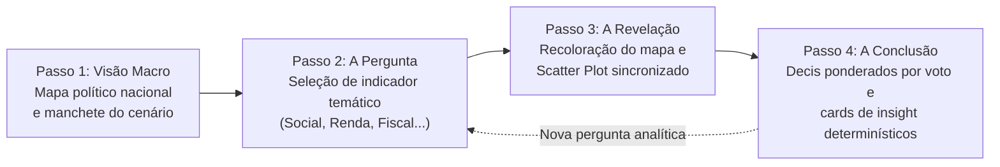
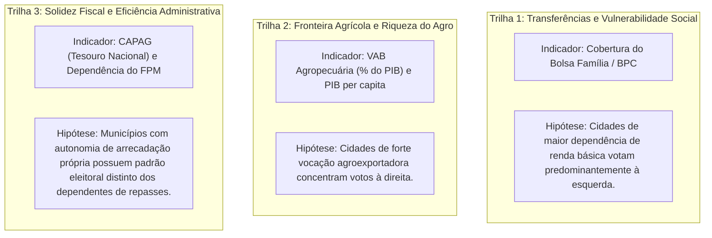

# 01 — Visão do Produto, Storytelling e Escopo do MVP

> **Como o Território Eleitoral foi concebido para transformar dados brutos e complexos em narrativas visuais acessíveis, transparentes e cientificamente embasadas.**

---

## 1. O Problema e a Proposta de Valor

A cobertura jornalística e o debate público em torno das eleições brasileiras frequentemente recaem em um modelo reducionista:
- Mapas que mostram exclusivamente o candidato vencedor em cada estado ou município ("mapa vermelho vs. azul").
- Análises dicotômicas superficiais que polarizam regiões inteiras (ex.: "o Norte/Nordeste vota no candidato A, o Sul/Centro-Oeste no candidato B") sem explicar as forças socioeconômicas subjacentes.
- Falta de ferramentas acessíveis para cruzar resultados eleitorais oficiais com a realidade material da população (renda, saneamento, dependência de programas sociais, perfil produtivo e solidez das contas públicas).

O **Território Eleitoral** foi projetado para superar essas limitações. Sua proposta de valor consiste em fornecer uma **plataforma pública e interativa de *storytelling* guiado por dados**, que investiga a pergunta estrutural:

> *"Como as condições econômicas, de vulnerabilidade social e de capacidade fiscal de um município se relacionam com o comportamento eleitoral de sua população nas urnas?"*

A ferramenta combina a cobertura exaustiva dos **5.571 municípios brasileiros** e das **27 Unidades da Federação** com o rigor de indicadores oficiais auditados, permitindo que cidadãos, jornalistas e cientistas sociais descubram correlações territoriais com respaldo estatístico.

---

## 2. Personas e Casos de Uso Reais

Para garantir foco e clareza de usabilidade, o MVP foi desenhado em torno de três perfis prioritários de usuários:

| Persona | Perfil e Necessidade | Resposta Implementada no MVP |
|---|---|---|
| **O Leitor Curioso** *(Cidadão / Estudante)* | Deseja entender o panorama político de forma direta, sem termos técnicos intimidados ou necessidade de conhecimentos prévios de estatística. Dispõe de 2 a 3 minutos. | **Jornada em 4 Passos (*Story Stepper*)** com linguagem simples, manchetes editoriais automáticas, mapa interativo e trilhas narrativas pré-configuradas em um clique. |
| **O Jornalista de Dados** | Precisa encontrar pautas analíticas, checar dados de municípios específicos, comparar extremos e gerar gráficos com fontes oficiais citáveis para redações. | **Ficha do Município**, busca instantânea com *autocomplete*, *Deep Linking* (URL reflete o estado exato da visualização) e metadados de fonte e ano em todos os cards. |
| **O Pesquisador / Analista** | Requer transparência metodológica absoluta, fórmulas documentadas, testes de hipótese e garantia de que os números não foram distorcidos por médias espúrias. | Painel com correlação de Pearson ($r$), Spearman ($\rho$), $p$-valor, regressão linear ($R^2$), decil ponderado por eleitorado e aviso formal contra falácia ecológica. |

---

## 3. A Experiência do Usuário: A Jornada em 4 Passos (*Story Stepper*)

Em vez de disponibilizar uma tela em branco com dezenas de filtros desarticulados, o Território Eleitoral guia o visitante por uma narrativa sequencial em 4 etapas lineares:

### Passo 1 — Visão Macro (O Cenário Político Inicial)
Ao carregar a plataforma, o usuário se depara com o panorama nacional das eleições de **Presidente (1º Turno de 2026)**.
- O mapa coroplético do Brasil exibe o saldo de votos entre os blocos políticos nos 5.571 municípios.
- Uma manchete editorial sintetiza a distribuição geral dos municípios e a participação proporcional de cada espectro político.
- O visitante pode alternar entre a visão de **Municípios** e a visão agregada por **Estados (UFs)**.

### Passo 2 — A Pergunta (A Escolha do Indicador)
O usuário é convidado a formular uma hipótese investigativa, escolhendo uma dimensão socioeconômica agrupada por eixos temáticos:
- **Vulnerabilidade e Proteção Social:** Cobertura do Bolsa Família, Benefício de Prestação Continuada (BPC), IDHM Longevidade e Educação.
- **Estrutura Econômica e Renda:** PIB per capita, peso do Agronegócio no PIB, dependência de serviços.
- **Gestão Pública e Finanças:** Capacidade de Pagamento do Tesouro Nacional (CAPAG), Dependência de Transferências Constitucionais (FPM).
- **Índices Compostos de Mercado:** Índice Firjan de Desenvolvimento Municipal (IFDM) e Índice de Progresso Social (IPS Brasil).

### Passo 3 — A Revelação (Recoloração e Dispersão Bivariada)
Ao selecionar o indicador:
- O mapa recolore-se instantaneamente (< 300 ms) exibindo a distribuição territorial do indicador segundo uma rampa de cores perceptualmente uniforme.
- O usuário pode alternar visualmente entre a visualização do **Indicador** e o **Voto Político**.
- O painel analítico abre um **Gráfico de Dispersão (Scatter Plot)** que plota cada município no plano cartesiano:
  - **Eixo X:** Valor do indicador socioeconômico.
  - **Eixo Y:** Percentual de votos válidos do bloco político selecionado.
  - **Linha de Tendência:** Regressão linear indicando a inclinação e dispersão da relação.

### Passo 4 — A Conclusão (Decis Ponderados e Síntese Editorial)
A plataforma sintetiza a evidência empírica por meio de dois instrumentos complementares:
1. **Gráfico de Barras por Decis Ponderados (D1 a D10):** Os municípios são agrupados em dez faixas iguais conforme o indicador. A altura de cada barra representa a participação do bloco político ponderada pela soma real de votos válidos do decil.
2. **Cards de Insights Determinísticos:** Sínteses textuais geradas sem uso de LLM, informando a diferença de votação entre o decil superior (D10) e inferior (D1), o grau de correlação estatística e os municípios extremos (outliers).

---

## 4. Trilhas Narrativas Prontas (*Story Tracks*)

Para guiar o visitante rapidamente pelas principais hipóteses do debate público nacional, o MVP incorpora três trilhas narrativas pré-configuradas acessíveis com um clique:

Cada trilha carrega automaticamente o indicador, a rampa cromática adequada, a visão geográfica e o card explicativo do contexto histórico daquele tema.

---

## 5. Limites Deliberados do MVP (Não-Objetivos)

Para manter a integridade científica e viabilizar a entrega rigorosa no prazo da eleição, definiram-se fronteiras claras sobre o que o sistema **não** faz:

1. **Não realiza previsões nem pesquisas de intenção de voto:** O sistema trabalha exclusivamente com dados apurados e consolidados oficiais do TSE. Não é um simulador preditivo nem termômetro de pesquisas amostrais.
2. **Não infere voto de indivíduos (Combate à Falácia Ecológica):** O sistema analisa municípios, não eleitores individuais. Dizer que um município com alta renda votou em determinado partido não significa que todas as pessoas ricas daquele município votaram nele. Essa distinção é imposta formalmente nos textos da plataforma.
3. **Não emite juízo de valor sobre partidos ou candidatos:** A plataforma não qualifica agremiações como "boas" ou "más". A categorização ideológica baseia-se exclusivamente em classificação acadêmica consagrada na literatura de ciência política brasileira.
4. **Zero LLM em tempo de execução:** Nenhum modelo gerador de texto é utilizado para redigir ou interpretar dados na API, eliminando alucinações matemáticas ou divergências textuais.
5. **Não expõe dados pessoais de cidadãos:** Dados de beneficiários do Bolsa Família ou de eleitores são apresentados unicamente como somatórios agregados municipais anônimos.

---

## 6. Critérios de Sucesso e Desempenho do Produto

O MVP foi homologado contra metas quantitativas estritas de experiência do usuário:

| Métrica de Desempenho | Meta do MVP | Resultado Atingido |
|---|---|---|
| **Tempo de Recoloração do Mapa** | < 300 ms ao trocar métrica/cargo | **~120 ms** (via GPU com `feature-state`) |
| **Tempo de Carga Inicial da Aplicação** | < 3,0 s em conexão 4G padrão | **~1,4 s** (Preact 10 + Vector Tiles compactos) |
| **Volume de Dados por Troca de Métrica** | < 100 KB transferidos | **~62 KB** (Payload colunar binário/JSON) |
| **Precisão Cadastral Municipal** | 100% dos 5.571 municípios cobertos | **5.571 municípios mapeados 1:1** sem perda |
| **Acessibilidade Digital** | Conformidade WCAG 2.2 AA | **100% de conformidade** (Tokens, ARIA e contraste) |
