# 02 — Arquitetura de Sistemas: O Paradigma "As Quatro Caixas"

> **Como a separação modular rigorosa entre Ingestão, Persistência, Inteligência e Apresentação viabilizou alta performance, manutenibilidade e confiabilidade científica no MVP.**

---

## 1. Visão Geral da Arquitetura

O **Território Eleitoral** foi projetado seguindo o modelo arquitetural conhecido como **"As Quatro Caixas"** (*Fábrica → Memória → Cérebro → Palco*). 

Esse modelo estabelece fronteiras estritas de isolamento funcional e unidirecionalidade no fluxo de dados, garantindo que cada componente execute uma única responsabilidade com excelência e sem efeitos colaterais:

```mermaid
flowchart LR
    subgraph Fontes["Fontes Públicas Oficiais"]
        TSE["TSE Dados Abertos<br/>Votação por Município/Zona"]
        IBGE["IBGE Cidades & Malha<br/>Geometrias e População"]
        CGU["Portal da Transparência<br/>Bolsa Família & BPC"]
        STN["Tesouro Nacional<br/>SICONFI & CAPAG"]
    end

    subgraph Fabrica["1. A Fábrica (ETL Python)"]
        EX["Extract<br/>Streaming + SHA-256 + Cache"]
        TR["Transform<br/>Pandas + Geopandas + Pandera"]
        XW["Crosswalk<br/>De-Para Estrito 1:1 TSE↔IBGE"]
        LD["Load<br/>PostGIS Bulk COPY"]
    end

    subgraph Memoria["2. A Memória (PostGIS)"]
        PG[("PostgreSQL 17 + PostGIS 3.5<br/>• 5.571 municípios (3 LODs)<br/>• Votação por Partido & Cargo<br/>• Views Materializadas (MVs)<br/>• Índices Espaciais GiST")]
    end

    subgraph Cerebro["3. O Cérebro (API & Analytics)"]
        API["FastAPI<br/>ORJSON + ETag/304"]
        TILE["Vector Tiles MVT<br/>ST_AsMVT Dinâmico"]
        STAT["Motor Estatístico<br/>Spearman, Pearson, Decis Ponderados"]
        INS["Gerador de Insights<br/>100% Determinístico (Zero LLM)"]
    end

    subgraph Palco["4. O Palco (Frontend Preact)"]
        MAP["MapLibre GL JS<br/>MVT + setFeatureState (<300ms)"]
        SCAT["Scatter Plot Híbrido<br/>D3 + Quadtree + Regressão"]
        DEC["Decile Bar Chart<br/>Ponderação por Eleitorado"]
        STORY["Story Stepper & Tracks<br/>Jornada em 4 Passos"]
    end

    Fontes --> Fabrica
    Fabrica --> Memoria
    Memoria --> Cerebro
    Cerebro -->|"Tiles binários .pbf"| MAP
    Cerebro -->|"Valores compactos JSON"| SCAT
    Cerebro -->|"Insights & Métricas"| STORY
```

---

## 2. Detalhamento das Quatro Caixas

### Caixa 1: A Fábrica (Engenharia de Dados & Ingestão)
- **Localização no repositório:** `backend/src/territorio/etl/`
- **Tecnologias:** Python 3.12, `pandas`, `geopandas`, `pyogrio`, `pandera`, `httpx`, `typer`.
- **Papel:** É o pipeline batch responsável por coletar, validar e carregar os dados brutos governamentais no banco.
- **Como opera:**
  1. **Extract:** Efetua streaming com controle de backoff, valida o hash de integridade SHA-256 e armazena cópias imutáveis em cache local (`backend/data/raw/`).
  2. **Transform:** Normaliza nomenclaturas, remove caracteres especiais e aplica contratos de dados rigorosos via `pandera.DataFrameSchema`.
  3. **Crosswalk:** Executa o De-Para estrito 1:1 entre o código municipal eleitoral (`cd_tse`) e o código geográfico oficial (`cd_ibge`), falhando imediatamente caso encontre registros órfãos.
  4. **Load:** Carrega os dados no PostgreSQL utilizando operações de carga em massa (`COPY` / `bulk_insert`).
- **O que NÃO faz:** Não serve requisições HTTP, não gera estilos visuais e não formata dados para exibição.

### Caixa 2: A Memória (Banco Relacional & Espacial)
- **Localização:** PostgreSQL 17 + extensão PostGIS 3.5 (orquestrado via Docker Compose).
- **Tecnologias:** PostgreSQL 17, PostGIS 3.5, SQLAlchemy Core (DDL e migrações com Alembic).
- **Papel:** É a única fonte da verdade e o repositório de persistência de alta performance.
- **Como opera:**
  1. Armazena os limites territoriais dos 5.571 municípios simplificados em 3 Níveis de Detalhe (LOD 0, 1 e 2) através da função `ST_CoverageSimplify`, garantindo junções topológicas perfeitas sem fendas (*gaps*) ou sobreposições (*overlaps*).
  2. Indexa geometrias com árvores GiST (*Generalized Search Tree*) e dados tabulares com índices B-Tree compostos em chaves canônicas (`cd_ibge`, `ano`, `cargo`, `turno`).
  3. Mantém **Views Materializadas** (`mv_votacao_bloco_municipio`, `mv_resumo_cargo_nacional`) atualizadas após a carga do ETL, reduzindo o tempo de consulta analítica a menos de 50 milissegundos.
- **O que NÃO faz:** Não contém regras de negócio de visualização e não depende de conexões externas.

### Caixa 3: O Cérebro (API REST & Motor Analítico)
- **Localização:** `backend/src/territorio/api/` e `backend/src/territorio/analytics/`
- **Tecnologias:** FastAPI, `uvicorn`, `orjson`, `psycopg 3`, `scipy`, `numpy`.
- **Papel:** Orquestra as consultas analíticas, gera tiles vetoriais sob demanda e calcula todas as métricas estatísticas de forma 100% determinística.
- **Como opera:**
  1. **Geração de Vector Tiles MVT:** Executa consultas SQL diretas utilizando `ST_AsMVT(ST_AsMVTGeom(...))` para empacotar as geometrias em Mapbox Vector Tiles binários compactos (`.pbf`), servidos com cabeçalhos de cache imutável.
  2. **Motor Estatístico (`analytics/stats.py`):** Calcula coeficientes de correlação de Pearson ($r$) e Spearman ($\rho$), testes de hipótese ($p$-valor), regressão linear por mínimos quadrados ($R^2$, inclinação, intercepto) e decis ponderados por eleitorado.
  3. **Motor de Insights (`analytics/insights.py`):** Preenche templates de narrativa estruturados e auditáveis a partir das métricas calculadas, garantindo que o texto nunca divirja dos gráficos.
- **O que NÃO faz:** **Zero LLM em runtime.** Não consulta APIs pagas, não realiza scraping em tempo de requisição e não permite alteração de dados por clientes web (API estritamente *read-only*).

### Caixa 4: O Palco (Interface Web & Visualização Interativa)
- **Localização:** `frontend/src/`
- **Tecnologias:** Preact 10, `@preact/signals`, TypeScript, Vite, MapLibre GL JS 5.1, D3 (módulos focados: `d3-scale`, `d3-quadtree`, `d3-array`, `d3-shape`).
- **Papel:** Apresentar a narrativa ao usuário com máxima reatividade, fluidez visual e acessibilidade.
- **Como opera:**
  1. **Renderização Vetorial via WebGL:** MapLibre consome os tiles binários e os renderiza diretamente na placa de vídeo.
  2. **Recoloração Dinâmica em GPU:** Ao trocar de indicador ou cargo, o frontend não solicita novas geometrias. Ele recebe um array JSON compacto (~60 KB) com os novos valores por `cd_ibge` e os injeta na memória da GPU via `map.setFeatureState()`, alcançando tempos de recoloração de ~120 ms.
  3. **Sincronização Cruzada (Cross-Highlighting):** Um *hover* sobre um município no mapa aciona a busca espacial ultra-rápida no Scatter Plot via `d3-quadtree` e destaca o município na tabela de extremos e no gráfico de decis.
  4. **Deep Linking Reativo:** Todo o estado analítico (cargo, turno, bloco, indicador, município selecionado) é sincronizado bidirecionalmente com os parâmetros da URL (`URLSearchParams`), permitindo compartilhamento instantâneo.
- **O que NÃO faz:** **Proibido calcular estatísticas.** O Palco apenas renderiza dados calculados pelo Cérebro, eliminando inconsistências metodológicas entre clientes.

---

## 3. Matriz de Responsabilidades e Vedações

| Caixa | Responsabilidade Primária | O que NÃO Pode Fazer (Vedação) |
|---|---|---|
| **1. Fábrica** | Baixar, validar schemas com `pandera`, mapear códigos TSE↔IBGE, limpar geometrias e carregar no banco. | Servir requisições HTTP ou conter regras de exibição visual. |
| **2. Memória** | Persistir dados relacionais e espaciais com integridade referencial, índices GiST e views materializadas. | Calcular estatísticas complexas em tempo de requisição ou formatar strings. |
| **3. Cérebro** | Servir endpoints REST e MVT, executar regressões e gerar textos de insight determinísticos. | Efetuar downloads de dados brutos em runtime ou acionar modelos LLM. |
| **4. Palco** | Renderizar mapas WebGL, gráficos D3, gerenciar estado da URL e prover acessibilidade WCAG 2.2 AA. | Realizar cálculos estatísticos (médias, correlações, regressões ou decis). |

---

## 4. Por Que Esta Arquitetura Foi Escolhida para o MVP?

### 1. Eliminação de Latência Percebida (< 300 ms)
Em aplicações geoespaciais tradicionais com Leaflet ou GeoJSON comum, trocar de métrica exige o download de um arquivo JSON de 20 a 50 MB contendo todas as coordenadas dos 5.571 municípios, seguido pelo parse e recriação de milhares de nós no DOM ou canvas. Isso congelava navegadores móveis por mais de 5 segundos.
- **Solução no Território Eleitoral:** As geometrias são baixadas uma única vez em tiles compactos (`.pbf`). A troca de indicador baixa apenas números puros mapeados para `cd_ibge`. O MapLibre atualiza os tons de cor diretamente na GPU via *shaders* WebGL em menos de 150 ms.

### 2. Preact 10 com Signals vs. Frameworks Pesados
Para a camada de visualização, descartou-se Next.js/React tradicional:
- O pacote React + ReactDOM adiciona mais de 140 KB de bundle inicial e seu modelo de re-renderização por árvore (*Virtual DOM diffing*) sofre severos engasgos quando dezenas de elementos interativos (mapa, scatter de 5.571 nós, ranking, filtros) reagem a eventos contínuos de mouse (*hover*).
- O **Preact 10** pesa apenas **3 KB**, e com `@preact/signals`, qualquer alteração no município selecionado atualiza cirurgicamente apenas o componente que consome aquele sinal, sem acionar reconciliação no restante da página.

### 3. PostgreSQL 17 + PostGIS sem Servidores de Tiles Externos
Avaliou-se a introdução de ferramentas consagradas como *Martin* ou *pg_tileserv*:
- Embora excelentes para grandes bases de dados mundiais, a introdução de um servidor de tiles separado no MVP adicionaria mais um contêiner no Docker Compose, exigiria sincronização de portas, regras de CORS adicionais e complicaria o pipeline de deploy em nuvens gratuitas.
- **A Solução Adotada:** A função `ST_AsMVT` integrada a uma rota do FastAPI com cache em memória (LRU) supriu 100% da demanda do território nacional com respostas abaixo de 80 ms, mantendo a infraestrutura enxuta e confiável.
