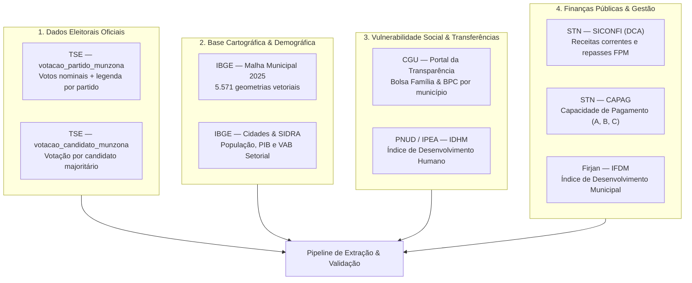

# 03 — Fontes de Dados e Engenharia de Integração

> **Mapeamento exaustivo das fontes públicas oficiais, formatos de extração, tratamento de integridade criptográfica e peculiaridades da federação brasileira no MVP.**

---

## 1. Visão Geral das Fontes Oficiais

O **Território Eleitoral** consolida informações provenientes de cinco grandes eixos da administração pública brasileira e da pesquisa acadêmica:

---

## 2. Detalhamento de Cada Fonte Pública

### 2.1 Tribunal Superior Eleitoral (TSE) — Dados Abertos
- **Repositório:** [Portal de Dados Abertos do TSE](https://dadosabertos.tse.jus.br/)
- **Arquivos Consumidos:**
  1. `votacao_partido_munzona_2026.csv`: Votação agregada por partido, município e zona eleitoral.
  2. `votacao_candidato_munzona_2026.csv`: Votação por candidato nominal.
- **Estrutura e Particularidades:**
  - **Formato:** Arquivos CSV compactados em `.zip`, delimitados por ponto-e-vírgula (`;`), historicamente codificados em `Latin-1` (ISO-8859-1) ou `UTF-8`.
  - **Colunas Fundamentais:** `NR_TURNO`, `CD_CARGO`, `SG_UF`, `CD_MUNICIPIO` (código TSE de até 5 dígitos), `NR_ZONA`, `SG_PARTIDO`, `QT_VOTOS_NOMINAIS_VALIDOS`, `QT_TOTAL_VOTOS_LEG_VALIDOS`.
- **Decisão no MVP:** Utilizar `votacao_partido_munzona` como base única para todos os cálculos de votação de bloco, somando votos nominais e votos de legenda (`QT_VOTOS_NOMINAIS_VALIDOS + QT_TOTAL_VOTOS_LEG_VALIDOS`). Isso garante a inclusão de 100% dos votos de legenda em eleições proporcionais (Deputados).

### 2.2 Instituto Brasileiro de Geografia e Estatística (IBGE)
- **Bases Consumidas:**
  1. **Malha Municipal Digital 2025:** Geopackage/Shapefile oficial dos 5.571 municípios brasileiros no sistema geodésico SIRGAS 2000 (EPSG:4674).
  2. **IBGE Cidades (API de Pesquisas):** População estimada e recenseada pelo Censo Demográfico.
  3. **SIDRA (Sistema IBGE de Recuperação Automática):** Tabela do Produto Interno Bruto dos Municípios (PIB total, PIB per capita e Valor Adicionado Bruto de Agropecuária, Indústria e Serviços).
- **Particularidades Técnicas:**
  - A API do IBGE Cidades utiliza códigos de **6 dígitos** (`cd_ibge6`, omitindo o dígito verificador final). O pipeline executa a recomposição imediata para o código canônico de **7 dígitos** (`cd_ibge`) por meio da fórmula de cálculo de módulo 10 do IBGE ou consulta à tabela de referência.

### 2.3 Controladoria-Geral da União (CGU) / Portal da Transparência
- **Bases Consumidas:**
  1. **Pagamentos do Programa Bolsa Família:** Quantidade de famílias beneficiárias e montante transferido mensalmente em cada município.
  2. **Benefício de Prestação Continuada (BPC):** Quantitativo de benefícios ativos pagos a idosos e pessoas com deficiência em situação de extrema vulnerabilidade.
- **Tratamento:** As somas de repasses e beneficiários são agregadas em nível anual e divididas pela população oficial do IBGE para derivar a **Taxa de Cobertura do Bolsa Família** e a **Taxa de Beneficiários do BPC por 1.000 habitantes**.

### 2.4 Secretaria do Tesouro Nacional (STN)
- **Bases Consumidas:**
  1. **SICONFI (Declaração de Contas Anuais - DCA):** Receitas Correntes Líquidas, Receitas Tributárias Próprias (IPTU, ISS, ITBI) e Transferências Correntes Constitucionais.
  2. **CAPAG (Capacidade de Pagamento dos Municípios):** Indicador sintético do Tesouro que classifica a saúde fiscal dos entes subnacionais em conceitos **A, B ou C** (habilitando ou não a contratação de operações de crédito com garantia da União).
- **Tratamento:** A partir dos dados do SICONFI, calcula-se a **Taxa de Dependência do FPM** ($\text{Repasses FPM} / \text{Receita Corrente Total}$), expondo a autonomia financeira real das prefeituras.

### 2.5 Indicadores Sintéticos de Mercado e Pesquisa
- **Firjan — IFDM:** Avaliação municipal com foco em Emprego & Renda, Saúde e Educação.
- **IPS Brasil (Índice de Progresso Social):** Avaliação holística de 53 indicadores sociais e ambientais, calculando o bem-estar da população sem levar em consideração variáveis financeiras.
- **PNUD / IPEA / FJP — IDHM:** Índice de Desenvolvimento Humano Municipal desmembrado nas dimensões Renda, Longevidade e Educação.

---

## 3. Gestão de Proveniência e Auditoria de Dados (`etl_run`)

Para garantir transparência jornalística e reprodutibilidade científica (requisitos RF-09 e RNF-03), cada execução de carga armazena um registro imutável na tabela `etl_run` do banco de dados:

| Coluna | Tipo | Finalidade de Auditoria |
|---|---|---|
| `id` | `UUID` | Identificador único da rodada de ingestão. |
| `source_name` | `VARCHAR` | Identificação do órgão de origem (ex.: `"TSE"`, `"IBGE_SIDRA"`, `"CGU"`). |
| `source_url` | `TEXT` | URL canônica de onde o arquivo bruto foi descarregado. |
| `sha256_hash` | `VARCHAR(64)` | Hash criptográfico SHA-256 verificado no momento do download. |
| `file_size_bytes` | `BIGINT` | Tamanho exato em bytes do arquivo original. |
| `ref_year` | `INT` | Ano de referência formal do indicador (ex.: Censo 2022, DCA 2024, Eleição 2026). |
| `created_at` | `TIMESTAMPTZ` | Timestamp de execução da carga na Fábrica. |

Esse registro permite que a interface do usuário exiba a qualquer momento um rodapé de transparência com a data exata da coleta e a versão dos dados utilizados.

---

## 4. Peculiaridades da Federação Brasileira e Casos de Borda

A federação brasileira possui idiossincrasias territoriais e eleitorais que exigem tratamento rigoroso no pipeline de dados:

### 4.1 Fernando de Noronha (PE) — Código IBGE `2605459`
- **Particularidade:** É um **distrito estadual** pertencente a Pernambuco, e não um município autônomo. Não possui prefeito nem câmara de vereadores; sua administração é nomeada pelo governador do estado.
- **Tratamento:** Nas eleições gerais, Fernando de Noronha vota para Presidente, Governador, Senador e Deputados. O IBGE atribui código de 7 dígitos (`2605459`). A malha geográfica e os dados do TSE são mantidos na base, mas indicadores fiscais exclusivos de prefeituras (como receitas municipais do SICONFI) recebem `NULL` explícito sem quebrar o pipeline.

### 4.2 Brasília / Distrito Federal — Código IBGE `5300108`
- **Particularidade:** O Distrito Federal não é dividido em municípios; acumula competências legislativas e fiscais estaduais e municipais. A votação é apurada em zonas eleitorais que cobrem suas Regiões Administrativas (Ceilândia, Taguatinga, Plano Piloto, etc.).
- **Tratamento:** O Distrito Federal é consolidado sob o código único `5300108`. Não possui eleições para Deputado Estadual, elegendo em seu lugar **Deputados Distritais** (`district_deputy`), devidamente suportados pelo modelo.

### 4.3 Votos no Exterior (ZZ) e Votos em Trânsito
- **Particularidade:** Eleitores brasileiros no exterior votam sob a circunscrição especial identificada pela sigla **"ZZ"**, com apuração exclusiva para o cargo de Presidente da República.
- **Tratamento:** A pseudo-UF "ZZ" não possui correspondente na malha territorial dos 5.571 municípios do IBGE. Seus votos são somados no total nacional consolidado para o cálculo do resultado da eleição, mas são **excluídos das malhas geoespaciais e das correlações territoriais** para evitar polígonos artificiais ou distorções estatísticas.

### 4.4 Fusões e Mudanças Partidárias Pós-2018
- **Particularidade:** Partidos históricos passaram por fusões recentes: o DEM e o PSL fundiram-se para criar o **União Brasil (UNIÃO)**; o PTB e o Patriota uniram-se formando o **PRD**; o PSC foi incorporado ao **Podemos (PODE)**.
- **Tratamento:** O arquivo de referência `party_ideology.yaml` mapeia cada sigla ativa com sua nota ideológica calculada pela média ponderada das bancadas dos partidos fundadores, preservando a coerência com a literatura acadêmica.
