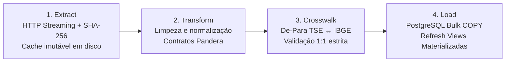

# 05 — Pipeline de ETL: A Fábrica de Dados

> **Especificação da engenharia de ingestão, validação com Pandera, Crosswalk estrito 1:1 e carregamento em massa no PostGIS.**

---

## 1. O Pipeline em 4 Estágios

A Fábrica de Dados (`src/territorio/etl`) opera como um pipeline batch sequencial, estruturado para transformar dezenas de gigabytes de dados públicos dispersos em tabelas relacionais e espaciais perfeitamente consistentes:



---

## 2. Detalhamento dos Estágios

### Estágio 1: Extração Resiliente e Cache Imutável (`extract.py`)
- **Streaming com Backoff Exponencial:** Utiliza `httpx` com suporte a downloads assíncronos e streaming para lidar com arquivos gigantescos do TSE sem sobrecarregar a memória RAM.
- **Validação Criptográfica de Integridade:** Cada arquivo descarregado tem seu hash SHA-256 calculado em tempo de fluxo. O pipeline compara o hash com os metadados esperados. Se houver divergência de 1 byte, o arquivo é descartado.
- **Cache Local Imutável:** Os arquivos brutos são preservados em `backend/data/raw/` com controle de permissão de apenas leitura, garantindo que execuções subsequentes não dependam da instabilidade dos portais de dados abertos.

### Estágio 2: Transformação e Contratos de Dados (`transform.py`)
- **Regra de Ouro da Validação:** **Nenhum dado entra no banco sem validação de schema.**
- **Contratos com Pandera (`pandera.DataFrameSchema`):**
  - Checagem estrita de tipos de dados (`int64`, `float64`, `string`).
  - Verificação de limites físicos (ex.: percentuais de votação obrigatoriamente no intervalo $[0, 100]$; população estritamente $> 0$).
  - Proibição de valores sentinela ou conversões implícitas: dado faltante torna-se explicitamente `NULL` / `NaN` com registro em log de auditoria. **Nunca se substitui dado ausente por zero.**

### Estágio 3: Crosswalk De-Para TSE ↔ IBGE (`crosswalk.py`)
- **O Desafio Estrutural:** O Tribunal Superior Eleitoral emprega uma codificação própria de até 5 dígitos (`cd_tse`), sem relação matemática com o código de 7 dígitos do IBGE (`cd_ibge`). Além disso, municípios homônimos com grafias ligeiramente diferentes (ex.: acentuação, hífen) geram desastres analíticos se cruzados por nome.
- **A Decisão do MVP ([ADR-001](13-decisoes-arquiteturais.md#adr-001--cd_ibge-7-dígitos-como-identificador-canônico-único-de-município)):**
  - Manter uma tabela de referência auditada e versionada em `backend/data/reference/de_para_tse_ibge.csv` mapeando cada um dos 5.571 municípios.
  - Toda operação de união (*merge*) entre bases eleitorais e territoriais utiliza:
    ```python
    df_merged = pd.merge(
        df_eleicao,
        df_crosswalk,
        on="cd_tse",
        how="outer",
        validate="many_to_one",
        indicator=True,
    )
    unmatched = df_merged[df_merged["_merge"] != "both"]
    if not unmatched.empty:
        raise ValueError(
            f"Falha de integridade no Crosswalk: {len(unmatched)} municípios não pareados!"
        )
    ```
  - **Falhar Alto:** Se um único município deixar de cruzar 1:1, o pipeline interrompe a execução com erro fatal imediatamente, impedindo a poluição do banco com dados corrompidos.

### Estágio 4: Carga em Massa no PostGIS (`load.py`)
- **Eliminação de ORM Lento:** O carregamento de milhões de linhas de votação através de ORM linha a linha geraria tempos de espera de dezenas de minutos.
- **Carga via `COPY` Binário / `bulk_insert`:** Os DataFrames limpos são convertidos em buffers colunares e injetados diretamente no PostgreSQL através do comando `COPY`, completando a carga nacional em segundos.
- **Idempotência Garantida:** Cada script de carga executa em blocos de transação atômica (`BEGIN ... COMMIT`), limpando partições prévias daquele ano/cargo antes da inserção, evitando registros duplicados.
- **Atualização de Views Materializadas:** Ao final do carregamento, a CLI executa automaticamente:
  ```sql
  REFRESH MATERIALIZED VIEW CONCURRENTLY mv_votacao_bloco_municipio;
  REFRESH MATERIALIZED VIEW CONCURRENTLY mv_resumo_cargo_nacional;
  ```

---

## 3. Comandos da CLI do Território

Toda a automação do pipeline é controlada pela interface de linha de comando `territorio` (`src/territorio/cli.py`), empacotada com Astral `uv` e `typer`:

```powershell
# Executa todas as etapas do pipeline de ponta a ponta
uv run territorio etl run --all

# Executa apenas a ingestão de geometrias do IBGE
uv run territorio etl run --only ibge_geometries

# Executa apenas os indicadores sociais e fiscais
uv run territorio etl run --only indicators

# Executa a suíte de verificação de aceitação dos dados
uv run territorio etl verify
```

A rotina `territorio etl verify` valida 100% dos critérios de integridade pós-carga:
- Presença exata de 5.571 municípios na tabela `municipio`.
- Nenhuma geometria nula ou inválida na tabela `geometria_municipio`.
- Soma dos percentuais de votos de candidatos igual a 100% dos votos válidos em cada município.
