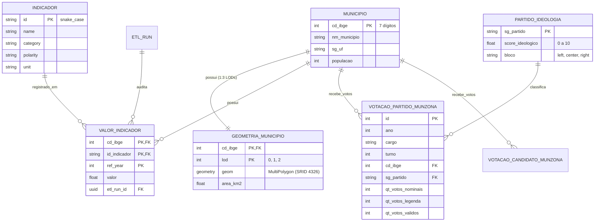

# 06 — Modelo de Dados e PostGIS: A Memória Espacial

> **Especificação das tabelas relacionais, índices GiST, simplificação topológica em 3 LODs e views materializadas no PostgreSQL 17 + PostGIS 3.5.**

---

## 1. Princípios da Modelagem de Dados

A camada de persistência (**A Memória**) foi estruturada para harmonizar três requisitos conflitantes:
1. **Rigor relacional:** Integridade referencial estrita e unicidade de registros em nível municipal.
2. **Alta performance analítica:** Consultas agregadas de milhões de votos em dezenas de milissegundos.
3. **Eficiência geoespacial:** Transmissão de geometrias otimizadas para a GPU sem fendas (*gaps*) ou sobreposições (*overlaps*).

O banco de dados utiliza **PostgreSQL 17** potencializado com a extensão geoespacial **PostGIS 3.5**.

---

## 2. Diagrama Entidade-Relacionamento (ERD)



---

## 3. Geometrias em 3 Níveis de Detalhe (LODs) via PostGIS

Um dos desafios centrais do MVP foi garantir a navegação rápida pelo mapa do Brasil sem sobrecarregar a rede ou o navegador.

### 3.1 Por Que 3 LODs?
- Exibir a malha detalhada de 5.571 municípios em um zoom nacional de tela cheia desperdiça poder computacional renderizando detalhes submilimétricos invisíveis a olho nu.
- Por outro lado, simplificar polígonos de forma ingênua (como o algoritmo de Ramer-Douglas-Peucker aplicado polígono por polígono) gera fendas artificiais (*gaps*) entre municípios vizinhos e ilhas sobrepostas (*overlaps*).

### 3.2 A Solução: `ST_CoverageSimplify`
O pipeline gera três camadas de geometrias preservando a topologia conjunta da malha:
1. **LOD 0 (Visão Nacional, Zoom < 5):** Tolerância de simplificação alta (~0,05 graus). Malha leve de ~1,8 MB, ideal para o primeiro carregamento da aplicação em conexões móveis.
2. **LOD 1 (Visão Regional/Estadual, Zoom 5 a 8):** Tolerância média (~0,01 graus). Equilíbrio ótimo para inspeção de estados e bacias regionais.
3. **LOD 2 (Visão Municipal Detalhada, Zoom > 8):** Tolerância mínima (~0,001 graus). Geometria de alta precisão para análise de contornos municipais específicos.

```sql
-- Geração de malha simplificada com preservação estrita de fronteiras
CREATE TABLE geometria_municipio_lod0 AS
SELECT
    cd_ibge,
    0 AS lod,
    ST_CoverageSimplify(geom, 0.05) OVER () AS geom
FROM geometria_municipio_base;
```

---

## 4. Otimização por Views Materializadas

Para garantir que as respostas analíticas da API retornem sempre abaixo de 50 milissegundos, as agregações mais custosas são pré-calculadas e armazenadas em **Views Materializadas**:

### 4.1 `mv_votacao_bloco_municipio`
Consolida os votos nominais e de legenda de cada bloco ideológico (`left`, `center`, `right`) por município, cargo e turno, já calculando o percentual sobre os votos válidos:

```sql
CREATE MATERIALIZED VIEW mv_votacao_bloco_municipio AS
SELECT
    v.ano,
    v.cargo,
    v.turno,
    v.cd_ibge,
    p.bloco,
    SUM(v.qt_votos_nominais + v.qt_votos_legenda) AS qt_votos_bloco,
    ROUND(
        SUM(v.qt_votos_nominais + v.qt_votos_legenda)::NUMERIC /
        NULLIF(SUM(SUM(v.qt_votos_nominais + v.qt_votos_legenda)) OVER (
            PARTITION BY v.ano, v.cargo, v.turno, v.cd_ibge
        ), 0) * 100, 2
    ) AS pct_votos_validos
FROM votacao_partido_munzona v
JOIN partido_ideologia p ON v.sg_partido = p.sg_partido
GROUP BY v.ano, v.cargo, v.turno, v.cd_ibge, p.bloco;

CREATE UNIQUE INDEX idx_mv_voto_bloco 
ON mv_votacao_bloco_municipio (ano, cargo, turno, cd_ibge, bloco);
```

### 4.2 Estratégia de Índices
- **Índices Espaciais GiST:** Criados em `geometria_municipio (geom)`, permitindo que o PostGIS recorte os polígonos de cada tile de forma quase instantânea na query `ST_AsMVT`.
- **Índices B-Tree Compostos:** Criados nas chaves de filtro mais frequentes, como `(ano, cargo, turno, cd_ibge)`, eliminando buscas sequenciais (*sequential scans*) nas tabelas de fatos.
