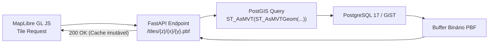

# 08 — API REST e Vector Tiles: O Cérebro Analítico

> **Especificação dos contratos HTTP, geração dinâmica de Vector Tiles via PostGIS, serialização com orjson e estratégia de cache.**

---

## 1. Princípios da Arquitetura da API

A camada de serviço (**O Cérebro**) foi desenvolvida em **FastAPI** para atender a critérios de extrema responsividade e baixo consumo de infraestrutura:
- **Serialização Ultrarrápida:** Utilização do serializador C em Rust `orjson`, reduzindo a latência de geração de respostas JSON em até 10× em comparação ao `json` padrão do Python.
- **Consultas Otimizadas:** Acesso ao banco através de **SQLAlchemy Core** com conexões assíncronas do **psycopg 3**, dispensando o mapeamento de objetos pesado de um ORM completo.
- **Cache HTTP Inteligente:** Respostas equipadas com cabeçalhos `ETag` calculados com base no hash do último `etl_run`. Requisições repetidas de clientes retornam status `304 Not Modified` sem processamento no servidor.

---

## 2. Rota de Vector Tiles MVT (`/tiles/municipalities/{z}/{x}/{y}.pbf`)

Em vez de recorrer a microsserviços dedicados de tiles (como *Martin* ou *pg_tileserv*), que complicariam o ambiente do MVP, o FastAPI atua como gerador de tiles binários nativos aproveitando o poder do PostGIS ([ADR-002](13-decisoes-arquiteturais.md#adr-002--vector-tiles-mvt-no-postgis--recoloração-via-feature-state)):



### 2.1 Consulta SQL Direta de Geração MVT
```sql
WITH bounds AS (
    SELECT ST_TileEnvelope(:z, :x, :y) AS env
),
mvtgeom AS (
    SELECT
        m.cd_ibge,
        m.nm_municipio,
        m.sg_uf,
        ST_AsMVTGeom(g.geom, b.env, 4096, 64, true) AS geom
    FROM geometria_municipio g
    JOIN bounds b ON ST_Intersects(g.geom, b.env)
    JOIN municipio m ON g.cd_ibge = m.cd_ibge
    WHERE g.lod = (
        CASE
            WHEN :z < 5 THEN 0
            WHEN :z BETWEEN 5 AND 8 THEN 1
            ELSE 2
        END
    )
)
SELECT ST_AsMVT(mvtgeom.*, 'municipalities', 4096, 'geom', 'cd_ibge') FROM mvtgeom;
```

---

## 3. Catálogo de Endpoints REST

### 3.1 `GET /api/v1/meta`
Retorna todos os metadados de inicialização necessários para a interface:
- Catálogo completo de indicadores socioeconômicos e fiscais com suas rampas de cor.
- Cargos eleitorais e turnos disponíveis no sistema.
- Versão da aplicação e data da última sincronização do ETL.

### 3.2 `GET /api/v1/metrics`
Entrega os valores numéricos por município para o mapa e gráficos em um payload colunar compacto (~60 KB):
- **Parâmetros de Consulta:**
  - `year` (`int`, obrigatório): Ano da eleição (ex.: `2026`).
  - `office` (`string`, obrigatório): Cargo eleitoral (`president`, `governor`, `senator`, etc.).
  - `round` (`int`, obrigatório): Turno (`1` ou `2`).
  - `indicator` (`string`, opcional): Identificador do indicador (ex.: `bolsa_familia_coverage_pct`).
- **Formato da Resposta:** Array ordenado de objetos com `cd_ibge`, `pct_left`, `pct_center`, `pct_right` e `indicator_val`.

### 3.3 `GET /api/v1/analytics/stats`
Executa o processamento estatístico em tempo real para o indicador e bloco selecionados:
- **Métricas Retornadas:**
  - `correlation_pearson`: Coeficiente $r$ e $p$-valor bicaudal.
  - `correlation_spearman`: Coeficiente $\rho$ e $p$-valor.
  - `linear_regression`: Coeficiente $R^2$, inclinação ($\beta_1$) e intercepto ($\beta_0$).
  - `deciles`: Lista de 10 objetos (D1 a D10) contendo intervalo de valores, quantidade de municípios e taxa eleitoral ponderada ($\sum \text{votos} / \sum \text{válidos}$).
  - `outliers`: Top 5 municípios com maior taxa de votação e Top 5 com menor taxa.
  - `insights`: Síntese textual editorial 100% determinística gerada por template ([ADR-003](13-decisoes-arquiteturais.md#adr-003--insights-100-determinísticos-zero-llm-no-caminho-dos-dados)).

### 3.4 `GET /api/v1/story/tracks`
Lista as três trilhas de storytelling temáticas pré-configuradas com título, descrição e estado sugerido de navegação.

### 3.5 `GET /health` e `GET /ready`
- `/health`: Liveness probe retornando `{"status": "ok"}`.
- `/ready`: Readiness probe verificando a conectividade com o banco PostGIS e integridade das views materializadas.
