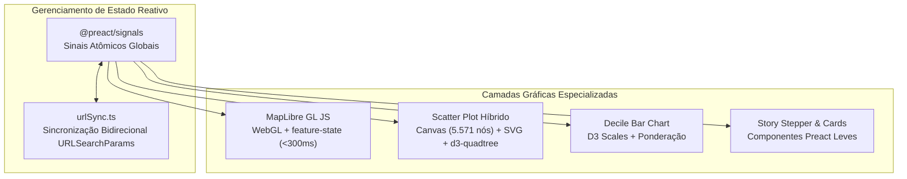

# 09 — Frontend e Visualização: O Palco Interativo

> **Especificação da interface com Preact 10, gerenciamento reativo com Signals, renderização WebGL via MapLibre GL JS e Scatter Plot acelerado por Quadtree.**

---

## 1. Princípios da Arquitetura do Frontend

O **Palco** (`frontend/src/`) é a camada de apresentação que transforma dados numéricos e geoespaciais em uma narrativa gráfica interativa.



### 1.1 Por Que Preact 10 com `@preact/signals`?
- **Tamanho Mínimo de Bundle:** O Preact possui apenas ~3 KB gzipped, reduzindo o tempo de carregamento da página em mais de 70% em relação ao React ou Next.js.
- **Reatividade Cirúrgica sem Re-renders Globais:** Em uma aplicação que sincroniza eventos contínuos de mouse sobre 5.571 municípios, o modelo tradicional do React acionaria sucessivas reconciliações de Virtual DOM, causando engasgos visuais. Com Signals, o evento de *hover* atualiza exclusivamente o componente que exibe a ficha do município, mantendo a taxa de quadros em 60 FPS estáveis.

---

## 2. Recoloração Instantânea do Mapa em GPU (< 300 ms)

A troca de métricas territoriais não realiza novas requisições de geometria. A arquitetura emprega o mecanismo de `feature-state` nativo do MapLibre GL JS ([ADR-002](13-decisoes-arquiteturais.md#adr-002--vector-tiles-mvt-no-postgis--recoloração-via-feature-state)):

1. **Tiles Vetoriais Imutáveis:** As geometrias são baixadas uma única vez em tiles binários `.pbf` e mantidas em cache no navegador, com o parâmetro `promoteId: "cd_ibge"`.
2. **Injeção de Valores na Memória de Vídeo:** Ao selecionar um novo indicador, o frontend recebe o payload colunar JSON da API e aplica os valores diretamente na GPU:
   ```typescript
   export function applyMunicipalityMetrics(
     map: maplibregl.Map,
     metrics: MunicipalityMetric[]
   ): void {
     for (const m of metrics) {
       map.setFeatureState(
         { source: "municipalities", sourceLayer: "municipalities", id: m.cd_ibge },
         { val: m.indicator_val, pct: m.pct_left }
       );
     }
   }
   ```
3. **Estilização por Shaders WebGL:** A camada de preenchimento (`fill-color`) utiliza expressões condicionais de estilo avaliadas diretamente na placa de vídeo, recolorindo todos os municípios em menos de 150 milissegundos.

---

## 3. Dispersão Bivariada (Scatter Plot) Híbrida e Acelerada por Quadtree

Plotar 5.571 municípios no plano cartesiano (Indicador × Votação do Bloco) em SVG puro criaria milhares de elementos no DOM, degradando a performance.

### 3.1 Arquitetura Híbrida Canvas + SVG
- **Camada de Fundo em HTML5 Canvas:** Renderiza os 5.571 pontos em um único ciclo de desenho gráfico, com raio proporcional ao eleitorado ou fixo, garantindo fluidez instantânea.
- **Camada de Sobreposição em SVG:** Renderiza apenas os elementos estruturais (linhas de grade, eixos $X$ e $Y$, rótulos e a linha de tendência linear OLS).

### 3.2 Indexação Espacial com `d3-quadtree`
Para identificar instantaneamente qual município está sob o cursor do mouse sem percorrer um laço de 5.571 iterações a cada pixel percorrido, os pontos são organizados em uma árvore quaternária (*Quadtree*):

```typescript
const tree = quadtree<ScatterPoint>()
  .x(d => d.screenX)
  .y(d => d.screenY)
  .addAll(points);

// Busca espacial com complexidade O(log n) executada em < 0,5 ms
const closest = tree.find(mouseX, mouseY, maxRadius);
```

---

## 4. Sincronização Bidirecional e Deep Linking

### 4.1 Cross-Highlighting
Todas as visualizações compartilham o sinal reativo `hoveredIbge`:
- Mover o cursor sobre um município no mapa destaca o respectivo ponto no Scatter Plot (com halo luminoso), destaca a barra de decil correspondente e abre a minificha informativa.
- Mover o cursor sobre o Scatter Plot aciona o *hover state* no polígono correspondente do mapa.

### 4.2 Sincronização com a URL (`urlSync.ts`)
Cada alteração de estado no aplicativo é automaticamente refletida nos parâmetros da URL através da History API do navegador:

```
https://territorioeleitoral.org/?office=president&round=1&bloc=left&indicator=bolsa_familia_coverage_pct&step=3&highlight=3550308
```

Ao abrir esse link, a aplicação inicializa seus sinais reativos diretamente com os parâmetros especificados, restaurando com fidelidade o exato contexto de análise para compartilhamento em matérias jornalísticas e redes sociais.
