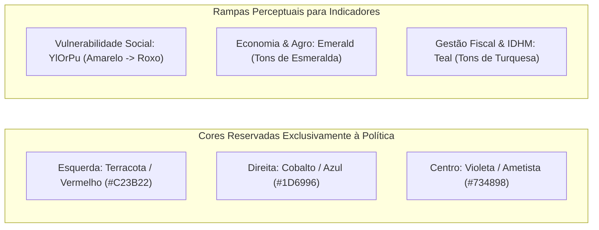

# 10 — Design System e Acessibilidade: "Atlas Cívico Editorial"

> **Especificação da identidade visual, a regra cromática inegociável, tokens semânticos e conformidade estrita com as diretrizes WCAG 2.2 AA.**

---

## 1. Conceito Visual: "Atlas Cívico Editorial"

O design do **Território Eleitoral** foi concebido sob a estética do **"Atlas Cívico Editorial"**: uma identidade visual sóbria, elegante e de alta credibilidade jornalística, remetendo a atlas geográficos de referência e publicações científicas consagradas.

Os princípios fundamentais de design são:
1. **Neutralidade e Isenção:** Nenhuma escolha estética, rampa de cor ou hierarquia visual pode favorecer ou desqualificar partidos políticos ou grupos sociais.
2. **Clareza Informacional:** Tipografia de alta legibilidade, números alinhados em formato tabular e contraste superior ao padrão.
3. **Acessibilidade Universal:** Toda informação visual deve ser interpretável por pessoas com daltonismo, usuários de teclado e leitores de tela.

---

## 2. A Regra Cromática Inegociável ([ADR-006](13-decisoes-arquiteturais.md#adr-006--separação-cromática-estrita-entre-espectro-político-e-indicadores))

A decisão visual mais crítica do projeto é a **separação estrita entre as paletas políticas e as paletas socioeconômicas**:



### Por Que Essa Separação É Obrigatória?
Se uma plataforma utiliza uma escala vermelho–azul para ilustrar pobreza ou PIB na mesma tela em que a Esquerda é vermelha e a Direita é azul:
- O cérebro do usuário faz associações cognitivas espúrias ("vermelho = ruim", logo o partido de esquerda seria ruim, ou vice-versa).
- Cria-se confusão imediata ao alternar a visualização entre o mapa político e o mapa do indicador.

Por isso, **Vermelho e Azul são cores terminantemente proibidas para qualquer indicador socioeconômico ou fiscal**.

---

## 3. Tokens Semânticos e Paletas para Daltonismo

Todos os estilos do frontend derivam exclusivamente das variáveis declaradas em `frontend/src/styles/tokens.css`:

### 3.1 Paletas Sequenciais para Indicadores (7 Níveis de Quantis)
- **`YlOrPu` (Amarelo → Laranja → Roxo):** Utilizada para taxas de cobertura social (Bolsa Família, BPC) e dependência do FPM. Perceptualmente segura para deuteranopia e protanopia.
- **`SequentialTeal` (Turquesa):** Utilizada para IDHM, serviços e receitas tributárias próprias.
- **`SequentialEmerald` (Esmeralda):** Utilizada para PIB per capita e participação do agronegócio.

### 3.2 Tipografia Tabular
Para assegurar que colunas numéricas permaneçam perfeitamente alinhadas verticalmente durante atualizações reativas, todo elemento numérico na interface utiliza:

```css
.tabular-nums {
  font-variant-numeric: tabular-nums;
  font-feature-settings: "tnum";
}
```

---

## 4. Acessibilidade Digital (Conformidade WCAG 2.2 AA)

A plataforma incorpora padrões estritos de acessibilidade em conformidade com o nível AA das diretrizes internacionais WCAG 2.2:

### 4.1 Navegação Completa por Teclado
- Todos os controles (seletor de cargo, indicador, botões do *Story Stepper*, alternadores de visão) são acessíveis via tecla `Tab`.
- Elementos focados exibem um anel de foco visível e destacado de 2px (`outline: 2px solid var(--color-focus)`).

### 4.2 Respeito a Preferências de Movimento Reduzido
Para pessoas com transtornos vestibulares ou propensas a labirintite e enjoo de movimento, o sistema detecta `prefers-reduced-motion: reduce`:

```css
@media (prefers-reduced-motion: reduce) {
  * {
    animation-duration: 0.01ms !important;
    transition-duration: 0.01ms !important;
  }
}
```
No mapa, as transições suaves de voo de câmera (*flyTo*) são desabilitadas em favor de saltos de visualização instantâneos.

### 4.3 Alternativa Textual para Tecnologias Assistivas
Gráficos complexos (Canvas e MapLibre) são acompanhados por tabelas de dados semânticas em HTML (`<table>`), permitindo que usuários cegos navegando com NVDA, VoiceOver ou Orca leiam todos os números, médias de decis e extremos municipais.

### 4.4 Auditoria Automatizada em Testes
A suíte de testes do frontend possui um teste de regressão estrito (`frontend/tests/components.test.tsx`) que inspeciona o código-fonte de todos os componentes `.tsx` para garantir que nenhuma cor hexadecimal esteja hardcoded fora de `tokens.css`.
