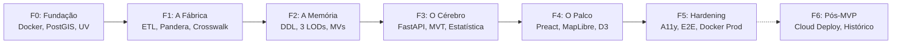
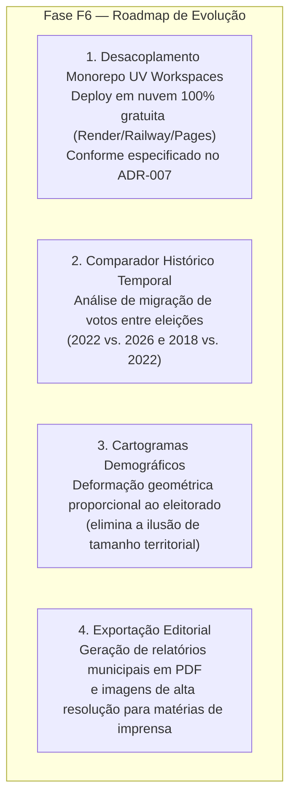

# 12 — Ciclo de Entrega do MVP e Roadmap Estratégico

> **Histórico das fases implementadas do Produto Mínimo Viável (F0 a F5) e direcionadores de evolução para o Pós-MVP (Fase F6).**

---

## 1. Visão Geral da Linha do Tempo

O desenvolvimento do **Território Eleitoral** seguiu um cronograma de engenharia disciplinado em seis fases sequenciais, priorizando o desacoplamento arquitetural e a validação contínua:

---

## 2. Retrospectiva das Fases Concluídas no MVP

### Fase F0 — Fundação e Infraestrutura de Desenvolvimento
- **Objetivo:** Estabelecer o alicerce técnico e a infraestrutura compartilhada sem dívida técnica.
- **Entregas Concluídas:**
  - Repositório monorepo simétrico com pastas dedicadas `backend/` e `frontend/`.
  - Configuração do **Docker Compose** orquestrando PostgreSQL 17 com extensão PostGIS 3.5.
  - Setup do gerenciador de pacotes **Astral `uv`** em `backend/` com Python 3.12, Ruff e Pytest configurados.
  - Setup do **Vite + Preact 10 + TypeScript + Vitest** em `frontend/`.
  - Configuração do pipeline de migrações com **Alembic**.

### Fase F1 — A Fábrica de Dados (ETL) e Ingestão
- **Objetivo:** Coletar, validar e cruzar as fontes governamentais com integridade matemática.
- **Entregas Concluídas:**
  - Módulo de download resiliente com streaming HTTP, verificação de hash SHA-256 e cache local em `backend/data/raw/`.
  - Implementação de contratos de dados estritos via **Pandera** para dados do TSE, IBGE e ministérios.
  - Construção do **Crosswalk De-Para TSE ↔ IBGE 1:1** (`data/reference/de_para_tse_ibge.csv`) com validação estrita que aborta caso algum município não seja pareado ([ADR-001](13-decisoes-arquiteturais.md#adr-001--cd_ibge-7-dígitos-como-identificador-canônico-único-de-município)).
  - Interface de linha de comando `territorio etl run` e rotina de homologação `territorio etl verify`.

### Fase F2 — A Memória (Modelagem Geoespacial e PostGIS)
- **Objetivo:** Estruturar a persistência relacional e espacial com foco em baixa latência.
- **Entregas Concluídas:**
  - DDL físico do PostgreSQL com tabelas `municipio`, `geometria_municipio`, `indicador`, `valor_indicador` e `votacao_partido_munzona`.
  - Geração de malhas simplificadas em **3 Níveis de Detalhe (LOD 0, 1 e 2)** usando `ST_CoverageSimplify`, eliminando gaps e overlaps entre municípios vizinhos.
  - Criação de **Views Materializadas** com índices exclusivos (`mv_votacao_bloco_municipio` e `mv_resumo_cargo_nacional`), garantindo respostas analíticas em menos de 50 ms.

### Fase F3 — O Cérebro (API REST e Motor Analítico)
- **Objetivo:** Prover os serviços web, gerar vector tiles nativos e processar métricas estatísticas determinísticas.
- **Entregas Concluídas:**
  - Aplicação **FastAPI** assíncrona com serialização em Rust via `orjson` e controle de cache HTTP (`ETag`/`304`).
  - Rota de Vector Tiles MVT binários (`/tiles/municipalities/{z}/{x}/{y}.pbf`) gerados diretamente no PostGIS via `ST_AsMVT` ([ADR-002](13-decisoes-arquiteturais.md#adr-002--vector-tiles-mvt-no-postgis--recoloração-via-feature-state)).
  - Motor estatístico puro em Python calculando correlações de Pearson ($r$), Spearman ($\rho$), testes $p$-valor, regressão linear OLS e decis ponderados por eleitorado ([ADR-005](13-decisoes-arquiteturais.md#adr-005--ponderação-por-votos-válidos-nos-decis-e-linguagem-ecológica-estrita)).
  - Motor de templates de insights editoriais determinísticos com **Zero LLM em runtime** ([ADR-003](13-decisoes-arquiteturais.md#adr-003--insights-100-determinísticos-zero-llm-no-caminho-dos-dados)).

### Fase F4 — O Palco (Frontend e Visualização Interativa)
- **Objetivo:** Renderizar a experiência de dados com alta fluidez visual e resposta instantânea ao usuário.
- **Entregas Concluídas:**
  - Aplicação Preact 10 com estado global gerenciado via `@preact/signals`.
  - Integração com **MapLibre GL JS**, implementando recoloração em GPU via `setFeatureState` com tempo de resposta de ~120 ms.
  - Gráfico de Dispersão bivariado híbrido (Canvas para 5.571 pontos + SVG estrutural) acelerado espacialmente com `d3-quadtree`.
  - Gráfico de barras de decis ponderados com filtro bidirecional interativo.
  - Implementação da **Jornada em 4 Passos (*Story Stepper*)** e das 3 Trilhas Narrativas prontas.
  - *Deep Linking* completo via sincronização de parâmetros na URL (`URLSearchParams`).

### Fase F5 — Integração Completa, Acessibilidade e Hardening
- **Objetivo:** Garantir estabilidade operacional, acessibilidade digital e prontidão para publicação.
- **Entregas Concluídas:**
  - Design System "Atlas Cívico Editorial" estruturado em tokens semânticos (`tokens.css`).
  - Aplicação da regra de separação cromática estrita (política em vermelho/azul; indicadores em Teal/Emerald/YlOrPu) ([ADR-006](13-decisoes-arquiteturais.md#adr-006--separação-cromática-estrita-entre-espectro-político-e-indicadores)).
  - Conformidade com acessibilidade **WCAG 2.2 AA** (navegação por teclado, anéis de foco, tabelas de dados acessíveis para leitores de tela e suporte a `prefers-reduced-motion`).
  - Suíte completa de 135+ testes automatizados (pytest e vitest) e script de validação E2E com navegador headless.
  - Configuração de build para produção com Docker Compose e Nginx (`docker-compose.prod.yml`).

---

## 3. Roadmap Pós-MVP (Fase F6)

Para além do escopo inicial da eleição de 2026, estão mapeadas as seguintes evoluções de alto impacto:

1. **Desacoplamento para Nuvem Gratuita ([ADR-007](13-decisoes-arquiteturais.md#adr-007--desacoplamento-da-fábrica-de-etl-do-backend-api-e-estratégia-de-deploy-cloud-free-tier)):** Separação formal do repositório em `services/api` (imagem Docker leve de < 150 MB e < 80 MB de RAM), `services/etl` (jobs batch sob demanda) e `frontend` (CDN global gratuito no Cloudflare Pages/Vercel).
2. **Comparador Histórico:** Expansão do modelo relacional para comportar eleições passadas (2022, 2018) com diagramas de fluxo (*Sankey*) ilustrando migrações de voto municipal entre espectros políticos.
3. **Cartogramas Demográficos:** Alternância entre o mapa geográfico convencional e cartogramas onde o tamanho de cada município é proporcional ao total de eleitores aptos, eliminando a ilusão de que regiões geograficamente gigantescas com baixa densidade populacional representam a maioria do eleitorado nacional.
4. **Exportação de Relatórios Jornalísticos:** Geração automática de dossiês em PDF com ficha completa do município, comparativo com a média estadual e nacional, e proveniência detalhada de cada número.
