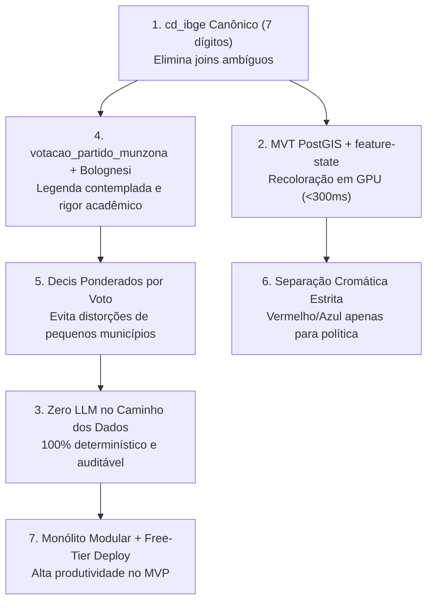

# Território Eleitoral — Documentação Oficial do Projeto

> **Plataforma aberta de *storytelling* de dados e inteligência geoespacial que cruza os resultados das Eleições Gerais com indicadores socioeconômicos e fiscais dos 5.571 municípios brasileiros.**

---

## 1. Visão Geral e Propósito

O **Território Eleitoral** é uma plataforma analítica e jornalística de código aberto criada para responder a uma pergunta estrutural da democracia brasileira:

> *"Como as condições econômicas, de vulnerabilidade social e de capacidade fiscal de um município se relacionam com o comportamento eleitoral de sua população nas urnas?"*

Em coberturas eleitorais tradicionais, mapas e gráficos costumam limitar-se a mostrar "quem venceu" ou a pintar estados inteiros de vermelho ou azul. Essa abordagem oculta as imensas heterogeneidades internas do país e ignora os determinantes materiais da escolha do eleitor.

O Território Eleitoral vai além: ele integra bases de dados públicas massivas e descentralizadas (**TSE, IBGE, CGU, Tesouro Nacional, PNUD, Firjan, IPEA**) em uma **experiência de navegação fluida, visualmente expressiva e rigorosamente fundamentada na literatura de ciência política e estatística**.

Esta documentação consolida o registro técnico completo do sistema, descrevendo detalhadamente **como** e **por que** as principais decisões de produto, arquitetura, engenharia de dados, modelagem espacial, estatística e design foram tomadas e aplicadas no Produto Mínimo Viável (MVP).

---

## 2. Mapa da Documentação Técnica

A documentação está organizada em 13 capítulos temáticos e aprofundados, cobrindo todo o ciclo de vida do software:

| # | Documento | Tema Principal | Descrição |
|---|---|---|---|
| 01 | [01 — Visão do Produto e Storytelling](01-produto.md) | **Produto & UX** | Problema resolvido, personas, a jornada em 4 passos (*Story Stepper*), trilhas narrativas e limites do MVP. |
| 02 | [02 — Arquitetura de Sistemas](02-arquitetura.md) | **Engenharia de Software** | O paradigma das "Quatro Caixas" (Fábrica, Memória, Cérebro e Palco), fluxo de dados, stack e isolamento de camadas. |
| 03 | [03 — Fontes de Dados e Integração](03-fontes-de-dados.md) | **Engenharia de Dados** | Mapeamento das APIs e repositórios do TSE, IBGE, CGU e Tesouro, hashes SHA-256 e proveniência auditável. |
| 04 | [04 — Catálogo de Indicadores](04-catalogo-de-indicadores.md) | **Domínio & Métricas** | Catálogo canônico de indicadores sociais, econômicos e fiscais, com fontes, polaridades e rampas de cor. |
| 05 | [05 — Pipeline de ETL (A Fábrica)](05-pipeline-etl.md) | **Pipelines de Dados** | O fluxo Extract → Transform → Crosswalk → Load, validações de schema via Pandera e garantia de integridade 1:1. |
| 06 | [06 — Modelo de Dados e PostGIS (A Memória)](06-modelo-de-dados.md) | **Banco de Dados** | DDL físico, índices espaciais GiST, views materializadas e simplificação topológica em 3 LODs via PostGIS. |
| 07 | [07 — Metodologia e Rigor Estatístico](07-metodologia.md) | **Estatística & Ciência Política** | Correlações (Spearman/Pearson), regressão linear, decis ponderados por voto, escala Bolognesi e combate à falácia ecológica. |
| 08 | [08 — API REST e Vector Tiles (O Cérebro)](08-api.md) | **Backend & MVT** | Endpoints FastAPI, geração dinâmica de Vector Tiles via `ST_AsMVT`, serialização com `orjson` e estratégia de cache HTTP. |
| 09 | [09 — Frontend e Visualização (O Palco)](09-frontend.md) | **Interface & WebGL** | Preact 10 com Signals, MapLibre GL JS, D3 Quadtree no scatter plot, recoloração via `feature-state` e Deep Linking. |
| 10 | [10 — Design System e Acessibilidade](10-design-system.md) | **Design & A11y** | Identidade visual "Atlas Cívico Editorial", tokens semânticos, rampas para daltonismo e conformidade WCAG 2.2 AA. |
| 11 | [11 — Padrões de Código e Testes](11-padroes-e-testes.md) | **Qualidade & QA** | Regras PEP 8 estritas, docstrings Google, 135+ testes automatizados (pytest + vitest), testes headless e auditoria de design tokens. |
| 12 | [12 — Evolução do MVP e Roadmap](12-plano-de-implementacao.md) | **Ciclo de Entrega** | Retrospectiva das Fases F0 a F5 entregues no MVP e direcionadores estratégicos para o Pós-MVP (Fase F6). |
| 13 | [13 — Decisões Arquiteturais (ADRs)](13-decisoes-arquiteturais.md) | **ADRs Consolidados** | Registro exaustivo das 7 Decisões Arquiteturais Estruturantes, alternativas rejeitadas, justificativas e consequências. |

---

## 3. As Sete Decisões de Ouro do MVP (Como e Por Quê)

O sucesso da entrega do MVP baseou-se em sete decisões arquiteturais inegociáveis. A tabela abaixo resume a essência de cada decisão:

1. **`cd_ibge` (7 dígitos) como Chave Única Canônica ([ADR-001](13-decisoes-arquiteturais.md#adr-001--cd_ibge-7-dígitos-como-identificador-canônico-único-de-município)):**
   - *Por quê:* O TSE usa códigos próprios de até 5 dígitos (`cd_tse`), o IBGE Cidades usa 6 dígitos sem dígito verificador e a malha vetorial usa 7 dígitos.
   - *Como foi aplicado:* Criou-se um De-Para 1:1 estrito na camada de ingestão. Toda a base, API e frontend operam unicamente com o código IBGE de 7 dígitos.

2. **Vector Tiles (MVT) no PostGIS com Recoloração via GPU ([ADR-002](13-decisoes-arquiteturais.md#adr-002--vector-tiles-mvt-no-postgis--recoloração-via-feature-state)):**
   - *Por quê:* Baixar um GeoJSON de 5.571 polígonos a cada clique consumiria dezenas de megabytes e travaria o navegador.
   - *Como foi aplicado:* Geometrias vetoriais são servidas em tiles binários `.pbf` imutáveis direto do PostGIS (`ST_AsMVT`). Os valores dos indicadores trafegam em JSONs compactos de ~60 KB aplicados instantaneamente na GPU via `map.setFeatureState()`, alcançando tempos de troca inferiores a 300 ms.

3. **Insights 100% Determinísticos — Zero LLM em Runtime ([ADR-003](13-decisoes-arquiteturais.md#adr-003--insights-100-determinísticos-zero-llm-no-caminho-dos-dados)):**
   - *Por quê:* Modelos de linguagem alucinam números, invertem sinais de correlações e sofrem de latência e custo por token.
   - *Como foi aplicado:* Todos os cálculos (Spearman, Pearson, decis) rodam em Python puro no backend e os textos de síntese são instanciados por templates determinísticos auditáveis. Reprodutibilidade científica absoluta com custo zero de inferência.

4. **Blocos Ideológicos via `votacao_partido_munzona` e Bolognesi et al. (2023) ([ADR-004](13-decisoes-arquiteturais.md#adr-004--cálculo-de-blocos-ideológicos-via-votacao_partido_munzona--bolognesi-et-al-2023)):**
   - *Por quê:* Nos cargos proporcionais (Deputados), milhões de eleitores votam apenas na legenda partidária. Usar apenas a tabela de candidatos desprezaria esses votos.
   - *Como foi aplicado:* A fonte oficial utilizada unifica votos nominais e de legenda. Os partidos são classificados de 0 a 10 segundo a metodologia de Bolognesi et al. (2023, Revista *Dados*).

5. **Decis Ponderados por Votos Válidos e Linguagem Ecológica ([ADR-005](13-decisoes-arquiteturais.md#adr-005--ponderação-por-votos-válidos-nos-decis-e-linguagem-ecológica-estrita)):**
   - *Por quê:* Municípios brasileiros variam de 800 a 12 milhões de habitantes. Uma média aritmética simples atribuiria o mesmo peso à capital paulista e à menor cidade de Roraima, deturpando a realidade eleitoral.
   - *Como foi aplicado:* O percentual de votos de cada decil é calculado matematicamente pela razão $\sum \text{votos} / \sum \text{válidos}$. Além disso, todas as interfaces e textos usam estritamente o sujeito gramatical "os municípios", combatendo a falácia ecológica de inferir intenções individuais a partir de agregados.

6. **Separação Cromática Estrita ([ADR-006](13-decisoes-arquiteturais.md#adr-006--separação-cromática-estrita-entre-espectro-político-e-indicadores)):**
   - *Por quê:* Misturar cores políticas (vermelho e azul) com métricas de vulnerabilidade social induz o leitor a vieses subconscientes de "bom" ou "ruim".
   - *Como foi aplicado:* Vermelho/Terracota e Azul/Cobalto são de uso exclusivo para votação de blocos políticos. Indicadores socioeconômicos e fiscais usam paletas perceptualmente uniformes e seguras para daltonismo (Teal, Emerald, YlOrPu).

7. **Monólito Modular no MVP com Desacoplamento para Nuvem Gratuita ([ADR-007](13-decisoes-arquiteturais.md#adr-007--desacoplamento-da-fábrica-de-etl-do-backend-api-e-estratégia-de-deploy-cloud-free-tier)):**
   - *Por quê:* Separar microsserviços durante o MVP adiciona fricção de rede e complexidade de orquestração. No entanto, contêineres gratuitos em nuvem (Render, Railway, Fly.io) possuem limites estritos de 512 MB de RAM.
   - *Como foi aplicado:* O MVP opera como monólito modular em desenvolvimento local. O pipeline de ETL roda desacoplado como rotina batch de linha de comando (`territorio etl run`), permitindo que a API web execute de forma *stateless* e consuma menos de 80 MB de memória em produção.

---

## 4. Glossário Canônico do Sistema

| Termo | Significado no Projeto |
|---|---|
| **cd_ibge** | Código do município de 7 dígitos atribuído pelo IBGE (ex.: `3550308` para São Paulo). É a chave primária universal do sistema. |
| **cd_tse** | Código eleitoral do município atribuído pelo TSE (até 5 dígitos, ex.: `"01007"`). Utilizado exclusivamente na etapa de extração. |
| **Crosswalk (De-Para)** | Tabela de equivalência estrita 1:1 entre códigos do TSE e códigos do IBGE com validação obrigatória contra dados do Censo. |
| **LOD (Level of Detail)** | Níveis de simplificação topológica da malha municipal (LOD 0 nacional, LOD 1 estadual e LOD 2 detalhado) calculados via PostGIS. |
| **MVT (Mapbox Vector Tile)** | Formato binário compacto (`.pbf`) baseado em Protocol Buffers para transmissão ultra-rápida de geometrias vetoriais. |
| **feature-state** | Mecanismo do MapLibre GL JS que atualiza dinamicamente propriedades de estilo de polígonos na memória da GPU sem recarregar tiles. |
| **Bloco Ideológico** | Classificação tripartite (`left`, `center`, `right`) agregada a partir da nota ideológica contínua (0 a 10) de cada partido político. |
| **Votos Válidos** | Total de votos destinados a candidatos nominais e legendas partidárias, excluindo expressamente votos brancos e nulos. |
| **Decil Ponderado** | Divisão dos 5.571 municípios em 10 grupos ordenados pelo indicador, cuja taxa eleitoral é a razão ponderada da soma dos votos. |
| **Falácia Ecológica** | Viés cognitivo e estatístico de atribuir a indivíduos conclusões deduzidas a partir de dados territoriais agregados. |
| **etl_run** | Registro imutável de proveniência de cada execução de dados (URL de download, hash SHA-256 e timestamp de coleta). |
