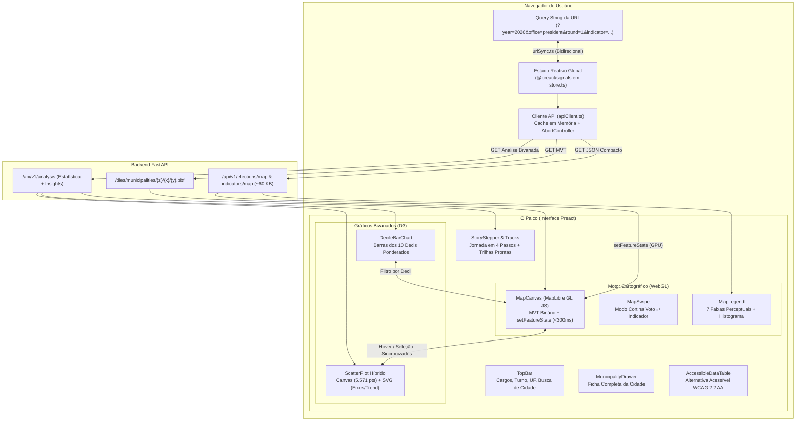

# Território Eleitoral — Frontend ("O Palco")

> **Aplicação web interativa de *storytelling* de dados eleitorais e inteligência geoespacial, construída com foco em alta performance, fidelidade cartográfica, acessibilidade (WCAG 2.2 AA) e renderização determinística.**

[](https://preactjs.com)
[-3178C6.svg?logo=typescript&logoColor=white)](https://www.typescriptlang.org)
[](https://maplibre.org)
[-F9A03C.svg?logo=d3.js&logoColor=white)](https://d3js.org)
[](https://vitejs.dev)
[](https://vitest.dev)
[]()

---

## Sumário

1. [Visão Geral e Princípios](#visão-geral-e-princípios)
2. [Arquitetura da Aplicação](#arquitetura-da-aplicação)
3. [Estrutura de Pastas e Componentes](#estrutura-de-pastas-e-componentes)
4. [Motor Cartográfico (MapLibre GL JS)](#motor-cartográfico-maplibre-gl-js)
   - [Tiles Vetoriais MVT e Estilo Local](#tiles-vetoriais-mvt-e-estilo-local)
   - [Pintura Instantânea via `feature-state` (< 300 ms)](#pintura-instantânea-via-feature-state--300-ms)
   - [Alternância Territorial (Municípios vs. UFs)](#alternância-territorial-municípios-vs-ufs)
   - [Modo Cortina / Map Swipe](#modo-cortina--map-swipe)
5. [Visualizações Bivariadas e D3.js](#visualizações-bivariadas-e-d3js)
   - [Scatter Plot de Alta Densidade (Canvas + SVG)](#scatter-plot-de-alta-densidade-canvas--svg)
   - [Decis Ponderados por Votos Válidos](#decis-ponderados-por-votos-válidos)
   - [Sincronização Cruzada Bidirecional](#sincronização-cruzada-bidirecional)
6. [Estado Reativo e Deep Linking na URL](#estado-reativo-e-deep-linking-na-url)
7. [Jornada de Storytelling e Trilhas Editoriais](#jornada-de-storytelling-e-trilhas-editoriais)
8. [Design System ("Atlas Cívico Editorial")](#design-system-atlas-cívico-editorial)
   - [Governança Cromática e Reserva Política](#governança-cromática-e-reserva-política)
   - [Rampas Seguras para Daltonismo](#rampas-seguras-para-daltonismo)
   - [Tipografia Tabular e Zero Layout Shift](#tipografia-tabular-e-zero-layout-shift)
   - [Diretrizes Anti-"AI Slop"](#diretrizes-anti-ai-slop)
9. [Acessibilidade (WCAG 2.2 AA)](#acessibilidade-wcag-22-aa)
10. [Desenvolvimento Local e Scripts](#desenvolvimento-local-e-scripts)
11. [Containerização e Produção (Nginx)](#containerização-e-produção-nginx)
12. [Regras Inegociáveis do Frontend](#regras-inegociáveis-do-frontend)
13. [Documentação de Referência](#documentação-de-referência)

---

## Visão Geral e Princípios

O frontend do **Território Eleitoral** é a 4ª caixa do sistema: **O Palco**.

Sua missão é dar vida visual, fluidez e inteligência cartográfica às correlações entre os resultados eleitorais da Eleição Geral de 2026 e os indicadores sociais, econômicos e fiscais dos 5.571 municípios brasileiros.

> [!IMPORTANT]
> **A Regra de Ouro do Frontend:** O frontend **NÃO realiza cálculos estatísticos nem redige textos de insight**.
> Todo valor numérico ($r$, $\rho$, $R^2$, taxas de decil ponderadas, parâmetros de regressão) e textos narrativos são calculados de forma 100% determinística no backend científico. O frontend consome esses dados e atua como uma lente de alta precisão para o usuário.

---

## Arquitetura da Aplicação

A arquitetura do frontend é projetada para eliminar sobrecargas comuns de frameworks modernos (*Zero Virtual DOM Thrashing*), combinando **Preact 10**, estado reativo fino com **`@preact/signals`**, mapas vetoriais acelerados por hardware via **MapLibre GL JS** e módulos especializados do **D3.js**:



---

## Estrutura de Pastas e Componentes

```text
frontend/
├── index.html                   # Shell HTML com montagem no elemento #app
├── package.json                 # Dependências Preact, MapLibre, D3, TypeScript e Vitest
├── tsconfig.json                # Configuração estrita do compilador TypeScript
├── vite.config.ts               # Bundler Vite com proxy para /api e /tiles (porta 8000)
├── nginx.conf                   # Configuração de produção Nginx (SPA fallback + gzip)
├── Dockerfile                   # Multi-stage Docker (targets: dev, build, prod)
├── src/
│   ├── main.tsx                 # Ponto de entrada: inicializa store, urlSync e monta App
│   ├── App.tsx                  # Layout orquestrador (TopBar + Palco Cartográfico + Painel)
│   ├── types/
│   │   └── api.ts               # Tipagens TypeScript alinhadas aos contratos da API REST
│   ├── state/
│   │   ├── store.ts             # Sinais reativos atômicos de exploração e datasets
│   │   └── urlSync.ts           # Sincronização bidirecional entre signals e query string
│   ├── services/
│   │   └── apiClient.ts         # Cliente HTTP tipado com cache em memória e cancelamento
│   ├── lib/
│   │   ├── scales.ts            # Escalas cromáticas D3 e expressões feature-state MapLibre
│   │   ├── format.ts            # Utilitários de formatação pt-BR (moeda, percentual, números)
│   │   └── spatial.ts           # Helpers geográficos e mapeamento de UFs brasileiras
│   ├── data/
│   │   └── storyTracks.ts       # 7 trilhas narrativas pré-configuradas (Bolsa Família, IDHM, etc.)
│   ├── components/
│   │   ├── TopBar.tsx           # Barra superior: Cargo, Turno, UF e busca com autocomplete
│   │   ├── StoryStepper.tsx     # Seletor das 4 etapas da narrativa
│   │   ├── StoryTracksBar.tsx   # Carrossel de atalhos rápidos das trilhas de investigação
│   │   ├── MapCanvas.tsx        # Motor WebGL MapLibre GL JS com renderização vetorial
│   │   ├── MapLegend.tsx        # Legenda flutuante com faixas de cor e toggle de camada
│   │   ├── MapSwipe.tsx         # Modo Cortina / Comparação dividida lado a lado
│   │   ├── MapTooltip.tsx       # Tooltip flutuante sincronizado ao cursor
│   │   ├── ScatterPlot.tsx      # Gráfico de dispersão híbrido (Canvas + SVG + Quadtree)
│   │   ├── DecileBarChart.tsx   # Gráfico dos 10 decis populacionais ponderados
│   │   ├── IndicatorPicker.tsx  # Modal/Gaveta de seleção de indicadores agrupados por tema
│   │   ├── InsightCards.tsx     # Exibição dos cards de insight textuais gerados pela API
│   │   ├── ExtremesContrastCard.tsx # Contraste dos municípios com maiores e menores valores
│   │   ├── PersonalAnchorCard.tsx   # Cartão de ancoragem pessoal ("Compare sua cidade")
│   │   ├── StateFocusCard.tsx   # Cartão de foco regional quando uma UF está filtrada
│   │   ├── StateLabelsOverlay.tsx   # Rótulos geográficos das siglas das UFs
│   │   ├── MunicipalityDrawer.tsx   # Ficha técnica completa do município selecionado
│   │   ├── MethodologyModal.tsx # Modal com fontes, classificação Bolognesi e aviso ecológico
│   │   └── AccessibleDataTable.tsx  # Tabela semântica acessível para leitores de tela
│   └── styles/
│       ├── tokens.css           # Tokens CSS de cores, superfícies, tipografia e bordas
│       └── app.css              # Estilos globais de layout flexível, painéis e animações
└── tests/                       # Suíte de testes com Vitest e JSDOM
    ├── apiClient.test.ts        # Testes de chamadas e cache do cliente API
    ├── components.test.tsx      # Testes de montagem e interação dos componentes Preact
    ├── format.test.ts           # Testes de formatação pt-BR
    ├── scales.test.ts           # Testes de governança cromática e interpolação D3
    ├── spatial.test.ts          # Testes de resolução de limites e UFs
    └── urlSync.test.ts          # Testes de serialização e desserialização da query string
```

---

## Motor Cartográfico (MapLibre GL JS)

O mapa é o componente central da experiência. Implementado em [`src/components/MapCanvas.tsx`](src/components/MapCanvas.tsx), ele utiliza a biblioteca de código aberto **MapLibre GL JS 5.1** com aceleração WebGL nativa.

### Tiles Vetoriais MVT e Estilo Local
- **Independência de Serviços Pagos:** O mapa é inicializado com um estilo JSON totalmente autônomo, sem requisições a serviços externos (Mapbox, Google Maps ou Carto).
- **Consumo Direto do PostGIS:** As geometrias são servidas via Mapbox Vector Tiles binários compactos (`.pbf`) gerados na rota `/tiles/municipalities/{z}/{x}/{y}.pbf`.
- **Topologia em Camadas:**
  1. `mun-fill`: Preenchimento coroplético dos municípios orientado por expressões `feature-state`.
  2. `mun-border`: Traçado sutil das fronteiras municipais (com opacidade dinâmica proporcional ao zoom).
  3. `uf-border`: Fronteiras estaduais em destaque contínuo.
  4. `mun-highlight`: Linha de contorno de realce para municípios sob `hover`, selecionados ou pertencentes ao decil ativo.

### Pintura Instantânea via `feature-state` (< 300 ms)
Tradicionalmente, mudar o indicador em um mapa de 5.571 polígonos exigiria baixar novos GeoJSONs de dezenas de megabytes. No Território Eleitoral:
1. As geometrias vetoriais são baixadas **apenas uma vez** e cacheadas pela GPU.
2. Ao trocar de cargo ou indicador, o frontend faz uma requisição leve (~60 KB de inteiros e floats compactos).
3. A função `applyMetricToMap()` aplica os novos valores diretamente no estado da GPU via `map.setFeatureState()`:
   ```ts
   for (let i = 0; i < rows.length; i++) {
     const [cdIbge, metric] = rows[i];
     map.setFeatureState(
       { source: "territorio-mun", sourceLayer: "municipalities", id: cdIbge },
       { metric }
     );
   }
   ```
4. A recoloração é instantânea (abaixo de 16 ms na main thread), garantindo taxa de quadros estável a 60 fps sem qualquer congelamento de tela.

### Alternância Territorial (Municípios vs. UFs)
Através do seletor de abrangência territorial (`geoLevelSignal`), o usuário pode alternar instantaneamente entre a visualização por **Municípios (5.571)** e a visualização agregada por **Unidades da Federação (27 UFs)**. Ao mudar de nível, tanto o mapa quanto os dados do gráfico de dispersão e dos decis são atualizados em sincronia.

### Modo Cortina / Map Swipe
Implementado em [`src/components/MapSwipe.tsx`](src/components/MapSwipe.tsx):
- Permite comparar lado a lado, sobre o mesmo território geográfico, a **votação do bloco político** e o **indicador socioeconômico**.
- Uma divisória vertical interativa com arrasto divide a tela em tempo real, permitindo identificar visualmente se fronteiras eleitorais coincidem com transições de renda ou infraestrutura.

---

## Visualizações Bivariadas e D3.js

Para evitar o peso excessivo da biblioteca D3 monolítica, o projeto importa estritamente os módulos necessários: `d3-array`, `d3-scale`, `d3-format` e `d3-quadtree`.

### Scatter Plot de Alta Densidade (Canvas + SVG)
Localizado em [`src/components/ScatterPlot.tsx`](src/components/ScatterPlot.tsx):
- **Desafio de Performance:** Renderizar 5.571 elementos `<circle>` em SVG no DOM compromete a fluidez da página durante a interação.
- **Arquitetura Híbrida:**
  - **Camada `<canvas>` (fundo):** Desenha os 5.571 pontos com raio proporcional à raiz quadrada do eleitorado ($\sqrt{\text{valid\_votes}}$), acelerando a renderização gráfica.
  - **Camada `<svg>` (topo):** Desenha os eixos cartesianos com D3, a reta de tendência linear (`trendline`) e o anel de realce do município selecionado.
- **Busca Espacial Instantânea com `d3-quadtree`:** Durante o movimento do mouse, o cursor consulta a quadtree bidimensional, identificando o município sob foco em menos de $0{,}05\text{ ms}$.

### Decis Ponderados por Votos Válidos
Localizado em [`src/components/DecileBarChart.tsx`](src/components/DecileBarChart.tsx):
- Apresenta um gráfico de 10 barras horizontais (D1 a D10) representando os municípios ordenados pelo indicador.
- **Interatividade Bidirecional:** Passar o cursor ou clicar em uma barra de decil (ex.: D10 — os 10% mais ricos) aciona `activeDecileSignal`, iluminando instantaneamente todos os municípios daquele decil no mapa e destacando seus pontos no gráfico de dispersão.

### Sincronização Cruzada Bidirecional
O ecossistema visual opera em perfeita harmonia reativa:
- Passar o mouse sobre um município no **mapa** destaca o ponto no **scatter plot**, exibe o **tooltip** e acende a barra de **decil** correspondente.
- Passar o mouse sobre um ponto no **scatter plot** destaca o polígono no **mapa**.
- Clicar em qualquer ponto abre o **drawer lateral** com o raio-X completo do município.

---

## Estado Reativo e Deep Linking na URL

Todo o estado da aplicação é gerenciado com **`@preact/signals`** em [`src/state/store.ts`](src/state/store.ts).
Diferente de soluções convencionais (Redux, Zustand), os sinais atualizam diretamente os nós de texto e propriedades dos componentes sem disparar re-renderizações em cascata de componentes pais.

### Sincronização com a URL (`src/state/urlSync.ts`)
Toda exploração do usuário é sincronizada bidirecionalmente com os parâmetros de busca da URL (*query string*):

```text
https://plataforma.eleitoral.org/?year=2026&office=president&round=1&indicator=bolsa_familia_pc&bloc=right&layer=indicator&uf=BA&mun=2927408&step=3
```

- **Para Jornalistas e Pesquisadores:** Permite copiar o link da barra de navegação e compartilhar exatamente o mesmo estado visual (mesmo município selecionado, mesmo indicador, mesmo decil e mesmo nível de zoom).
- **Histórico do Navegador:** O botão "Voltar" do navegador reverte perfeitamente os passos de navegação da investigação.

---

## Jornada de Storytelling e Trilhas Editoriais

A plataforma guia o usuário por uma narrativa em 4 etapas através do componente [`StoryStepper.tsx`](src/components/StoryStepper.tsx):

| Etapa | Nome | Foco da Interface | Modo do Mapa | Painel Lateral |
|---|---|---|---|---|
| **Passo 1** | **A Visão Macro** | Panorama geral da eleição selecionada | Saldo político (`lr_balance`) | Votação nacional e estadual por bloco partidário |
| **Passo 2** | **A Pergunta** | Seleção temática de investigação | Mantém mapa | Catálogo categorizado de indicadores e perguntas norteadoras |
| **Passo 3** | **A Revelação** | Cruzamento visual dos dados | Indicador ativo | `ScatterPlot` + `DecileBarChart` + estatísticas ($\rho$, $r$, $R^2$) |
| **Passo 4** | **A Conclusão** | Síntese e conclusões determinísticas | Indicador com filtro de decis | `InsightCards` textuais + contraste de extremos + ficha municipal |

### Trilhas Editoriais Prontas (*Story Tracks*)
Disponíveis no carrossel de acesso rápido [`StoryTracksBar.tsx`](src/components/StoryTracksBar.tsx):
1. **Proteção Social e Bolsa Família:** Volume de repasses per capita vs. votação em blocos.
2. **Desenvolvimento Humano (IDHM):** Correlação com longevidade, educação e renda.
3. **Concentração de Renda (Gini):** O impacto da desigualdade extrema nas urnas.
4. **Desigualdade e CadÚnico:** Vulnerabilidade e famílias de baixa renda.
5. **O Cinturão do Agronegócio:** Participação da agropecuária no PIB municipal e o voto.
6. **Metrópoles vs. Interior:** A divisão política entre grandes capitais e o interior.
7. **Autonomia Fiscal Municipal:** Arrecadação própria frente à dependência do FPM.

---

## Design System ("Atlas Cívico Editorial")

Definido formalmente em [`src/styles/tokens.css`](src/styles/tokens.css) e fundamentado no [documento de design](../docs/10-design-system.md).

### Governança Cromática e Reserva Política
> [!IMPORTANT]
> **Regra Inegociável (ADR-006):** As cores **Vermelha** e **Azul** são **estritamente reservadas ao espectro político**:
> - **Esquerda:** Vermelho / Terracota (`--bloc-left: #C83E31`)
> - **Direita:** Azul / Cobalto (`--bloc-right: #2563EB`)
> - **Centro:** Âmbar / Laranja (`--bloc-center: #D97706`)
>
> Nenhum indicador socioeconômico pode utilizar escalas divergentes vermelho–azul, evitando que o leitor confunda dados de pobreza ou riqueza com alinhamento ideológico partidário.

### Rampas Seguras para Daltonismo
Os indicadores sociais utilizam paletas perceptuais com variação monotônica de luminância:
- **Economia, Educação e Índices:** `SequentialTeal` (tons de verde-petróleo ao azul escuro).
- **Transferências e Vulnerabilidade Social:** `SequentialAmberPurple` (`YlOrPu`: tons de lavanda ao roxo profundo, sem colidir com o vermelho eleitoral).
- **Gestão Fiscal e Finanças:** `SequentialEmerald` (tons esmeralda e verde-escuro).

### Tipografia Tabular e Zero Layout Shift
- As fontes do sistema utilizam fallbacks nativos limpos: `Newsreader`/`Georgia` para títulos editoriais, `Plus Jakarta Sans`/`Inter` para interface e `JetBrains Mono` para números e códigos IBGE.
- **Regra dos Números Tabulares:** Todo elemento que exiba números ou percentuais utiliza a classe CSS `.tabular-nums`:
  ```css
  font-variant-numeric: tabular-nums lining-nums;
  ```
  Isso garante que todos os algarismos possuam a mesma largura fixa, evitando que a interface "trema" ou cause oscilação de layout (*Cumulative Layout Shift - CLS*) durante o hover nos municípios.

### Diretrizes Anti-"AI Slop"
1. **Sem Hero Artificial:** A tela inicial é imediatamente a ferramenta analítica em pleno funcionamento.
2. **Sem Gradientes Neon:** Nada de fundos decorativos roxos ou efeitos vazios de brilho.
3. **Identificação Obrigatória:** Nenhum dado é exibido sem sua fonte oficial e seu ano de referência.
4. **Superfície Confortável:** O tema claro utiliza a superfície suave de papel cartográfico quente (`#F7F5F0`), reduzindo a fadiga visual.

---

## Acessibilidade (WCAG 2.2 AA)

Garantir o acesso universal à informação pública é premissa estrutural do projeto:

- **Modo Tabela Acessível ([`AccessibleDataTable.tsx`](src/components/AccessibleDataTable.tsx)):** Usuários com deficiência visual ou navegando exclusivamente por teclado podem alternar a visualização do mapa para uma tabela semântica ordenada por decis e extremos com suporte a leitores de tela.
- **Regiões Vivas (`aria-live="polite"`):** Mudanças de manchete e cards de conclusão são anunciadas suavemente aos leitores de tela.
- **Contraste Rigoroso:** Todas as combinações de texto e superfície atendem à razão mínima de contraste de 4.5:1 (WCAG AA).
- **Foco Visível:** Todos os botões, seletores e itens da busca possuem anéis de foco evidentes (`--border-focus: #1D4ED8`).
- **Respeito a `prefers-reduced-motion`:** Usuários com sensibilidade a movimento têm animações e o efeito `flyTo` do mapa automaticamente desativados.

---

## Desenvolvimento Local e Scripts

### Pré-requisitos
- **Node.js ≥ 22.0.0**
- **npm ≥ 10.0.0**
- Backend FastAPI ativo na porta `8000` (ou container Docker de backend em execução).

### Instalação e Execução

```powershell
# 1. Instalar as dependências do projeto
npm install

# 2. Iniciar o servidor de desenvolvimento Vite (com Hot Module Replacement)
npm run dev
# Acesse http://localhost:5173

# 3. Executar a checagem estrita de tipos TypeScript
npm run typecheck

# 4. Executar a suíte de testes unitários e de componentes com Vitest
npm run test:run

# 5. Executar os testes em modo contínuo (watch)
npm test

# 6. Compilar o bundle de produção otimizado
npm run build
```

---

## Containerização e Produção (Nginx)

O frontend dispõe de um [`Dockerfile`](Dockerfile) multi-stage focado em alta eficiência e segurança:

1. **Target `dev`:** Utilizado no desenvolvimento integrado (`docker compose up`) com suporte a live-reload na porta `5173`.
2. **Target `build`:** Executa a verificação estrita de tipos TypeScript (`tsc --noEmit`) e a compilação do Vite (`vite build`), gerando os artefatos estáticos minificados na pasta `dist/`.
3. **Target `prod`:** Imagem baseada em `nginx:alpine` ultra-leve (< 25 MB). Utiliza o [`nginx.conf`](nginx.conf) com:
   - Roteamento SPA fallback (`try_files $uri $uri/ /index.html`).
   - Compressão estática `gzip` ativada para JS, CSS, SVG e JSON.
   - Headers de segurança HTTP (`X-Frame-Options`, `X-Content-Type-Options`).
   - `HEALTHCHECK` automático integrado.

---

## Regras Inegociáveis do Frontend

1. **Zero cálculo estatístico no cliente:** O frontend apenas renderiza métricas e insights já computados pelo backend.
2. **`cd_ibge` (7 dígitos, `int`) como identificador único:** Todo estado, busca, seleção e amarração de features no mapa utiliza exclusivamente o código IBGE oficial.
3. **Reserva cromática inegociável:** Vermelho é Esquerda, Azul é Direita. Nunca utilize essas cores em indicadores sociais.
4. **Zero Layout Shift (CLS):** Tooltips e legendas possuem dimensões reservadas; o hover nunca desloca o layout ao redor.
5. **Deep Linking estrito:** Qualquer parâmetro de filtro que altere o que o usuário está vendo deve ser refletido na URL.

---

## Documentação de Referência

- [**README Geral da Plataforma**](../README.md) — Visão do produto, arquitetura macro e comandos gerais.
- [**README do Backend**](../backend/README.md) — Engenharia do pipeline de dados, PostGIS, API FastAPI e análises.
- [**AGENTS.md**](../AGENTS.md) — Diretrizes de código e regras para agentes e engenheiros.
- [**docs/09-frontend.md**](../docs/09-frontend.md) — Especificação técnica profunda da interface e do MapLibre.
- [**docs/10-design-system.md**](../docs/10-design-system.md) — Design system, tokens, paletas e especificações de acessibilidade.
- [**docs/13-decisoes-arquiteturais.md**](../docs/13-decisoes-arquiteturais.md) — ADRs arquiteturais estruturantes.
